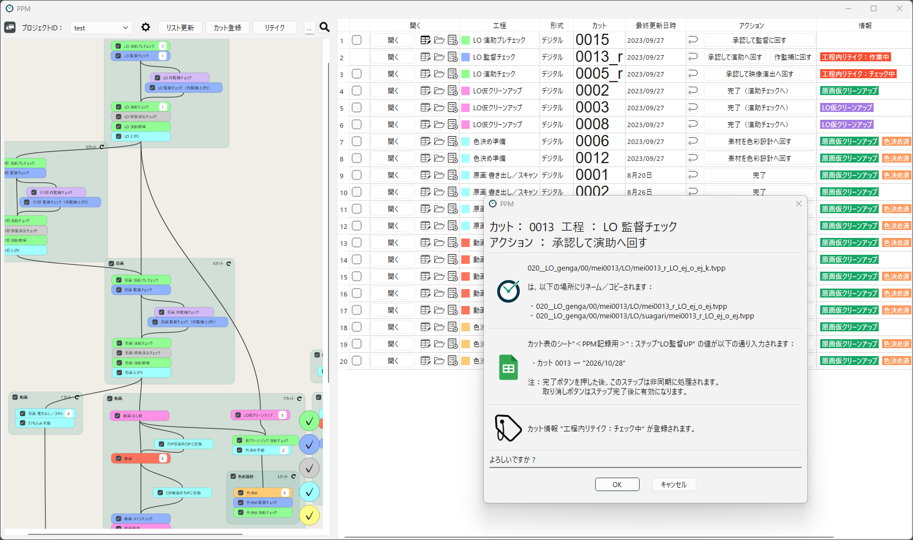

# PPM
(Ppm is Progress Manager)

[日本語は下にあります](#ppm-日本語)

PPM is a Windows application for managing the progress of animation production.
It looks at the files of each scene in a shared folder, lists which scene is in which workflow, and performs the file operations needed to move a scene forward (renaming, copying, writing to the cut list, and so on) with one button.

## Features

- **Files are the progress**: No dedicated server or database is needed. PPM decides which workflow each scene is in from the names and locations of its files.
- **One button to move a scene forward**: Pressing an action button runs predefined steps (rename, copy, create cue files, and so on) after a confirmation dialog, and they can be undone.
- **See your own scenes and the whole flow**: List the scenes in the workflows you are in charge of, and see the whole pipeline as a flowchart.
- **Logs and retakes**: Every operation is logged for each scene. Retakes are managed with take numbers.
- **Design your own pipeline**: Workflows, file naming rules, and action steps are set up in the project settings, without programming.
- **Integrations**: Writing progress to Google Spreadsheets and sending notifications to Google Chat.

## Manual

- [PPM Manual (English)](docs/index.md)
- [Installation](docs/getting-started/installation.md)
- [Tutorial: Moving a Scene Through the Pipeline](docs/getting-started/tutorial.md)

## License

PPM is released under the [BSD 3-Clause License](LICENSE).
It uses Qt under the LGPL v3, and some icons are based on Tabler Icons (MIT License). See [License](docs/about/license.md).

## Contributing

See [CONTRIBUTING.md](CONTRIBUTING.md). Bug reports and feature requests are welcome in [Issues](https://github.com/opentoonz/ppm/issues).

---

## PPM (日本語)

PPM は、アニメーション制作の進捗を管理するための Windows 用ソフトウェアです。
共有フォルダにあるカットのファイルを見て「どのカットが、いまどの工程にあるか」を一覧にし、工程を進めるときのファイル操作（リネーム・コピー・カット表の記録など）をボタンひとつで行います。

### 特長

- **ファイルがそのまま進捗になる**：専用のサーバーやデータベースは不要です。ファイルの名前と場所から、各カットがどの工程にあるかを判断します。
- **工程を進める操作をボタンひとつで**：アクションのボタンを押すと、あらかじめ決めた手順（リネーム、コピー、キューファイルの作成など）を、確認画面を挟んでまとめて実行します。実行した操作は取り消せます。
- **自分の担当のカットと、全体の流れが見える**：担当の工程にあるカットを一覧にし、工程のつながりをフローチャートで表示します。
- **履歴とリテイク**：カットごとに、すべての操作がログに残ります。リテイクは、テイク番号つきで管理できます。
- **パイプラインを自分たちで設計できる**：工程やファイルの命名規則、ボタンを押したときの手順を、プロジェクト設定の画面で組み立てられます。プログラムを書く必要はありません。
- **外部サービスとの連携**：Google スプレッドシートへの進捗の書き込みや、Google Chat への通知も行えます。

### マニュアル

- [PPM マニュアル（日本語）](docs/index.ja.md)
- [インストール](docs/getting-started/installation.ja.md)
- [チュートリアル：カットを1つ最後まで進める](docs/getting-started/tutorial.ja.md)

### ライセンス

PPM は、[BSD 3-Clause License](LICENSE) で公開しています。
Qt を LGPL v3 のもとで使っており、一部のアイコンは Tabler Icons（MIT License）をもとにしています。くわしくは [ライセンス](docs/about/license.ja.md) を参照してください。

### 開発に参加する

[CONTRIBUTING.md](CONTRIBUTING.md) を参照してください。不具合の報告や機能の要望は、[Issues](https://github.com/opentoonz/ppm/issues) で受け付けています。
