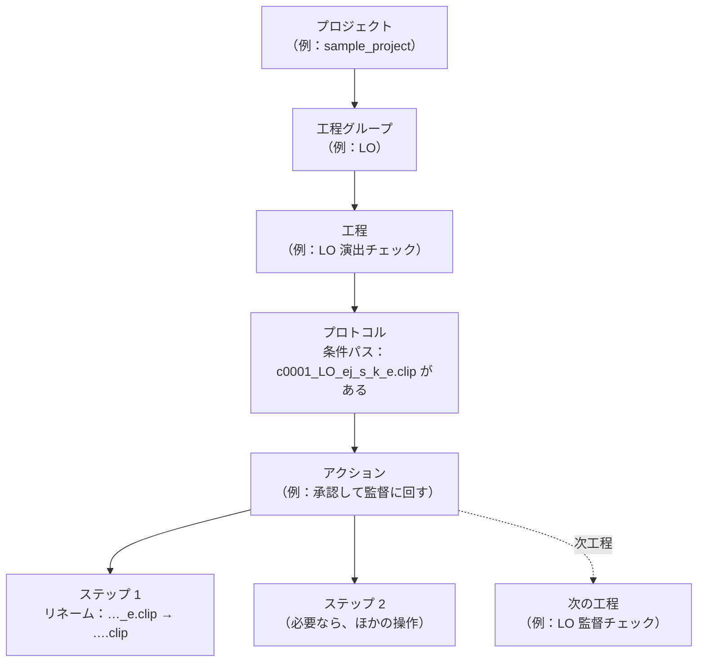
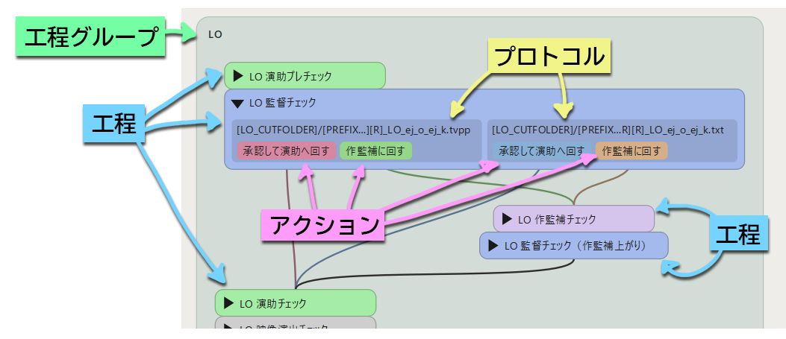

[English](glossary.md)

# 用語集

PPM のマニュアルと画面で使う用語を説明します。
アニメ制作の現場で使われている言葉と同じものもありますが、PPM の中では意味を少し絞って使っているものがあります。

## プロジェクトの組み立て

PPM のプロジェクトは、次のような入れ子の構造になっています。



- 1つのプロジェクトには、複数の**工程グループ**があります。
- 1つの工程グループには、複数の**工程**があります。
- 1つの工程には、1つ以上の**プロトコル**があります。プロトコルは「どんなファイルがあれば、カットがこの工程にいるとみなすか」（**条件パス**）を決めます。
- 1つのプロトコルには、1つ以上の**アクション**があります。アクションは、一覧に表示されるボタンです。
- 1つのアクションは、順に実行される**ステップ**と、カットが次に進む**次工程**からできています。



## PPMで使う用語

### カット

作品を構成する単位で、PPM が進捗を管理する対象です。英語版の画面では「Scene」と表示されます。
カットは任意の文字列を設定できますが、`0001` のようなカット番号で区別することが多いです。
ファイル名やフォルダ名には、プロジェクト毎に決めた**接頭辞**（サンプルでは `c`）を付けた `c0001` の形で使われます。

複数のカットを1つにまとめた**兼用カット**は、`0150_0152` のようにカット名を `_` でつないで表します。

### 話数

テレビシリーズのように、複数の話数で構成される作品で使います。
話数を使うプロジェクトでは、画面上部のコンボボックスで作業する話数を切り替えます。
1本の映画のように話数がない作品では使いません。

### シークエンス

カットのファイルやログを、100カットごとのフォルダに分けて置くための区分です。
カット番号の下2けたを除いた数字が、シークエンスになります（`0001`〜`0099` は `00`、`0150` は `01`）。
シークエンスを使うかどうかは、プロジェクトごとに決めます。

### 工程グループ

LO・原画・動画・仕上のような、工程の大きなまとまりです。
カットは、通常どれか1つの工程グループに**所属**しています。
カットがどの工程グループに所属しているかは、PPM が記録しています（[進捗はファイルで管理される](progress-files.ja.md) を参照）。

工程グループごとに、**カットフォルダ**（そのグループのカットのファイルを置くフォルダ）の場所を設定します。

### 工程

「LO 演出チェック」や「原画 作監チェック」のように、カットが通過する1つの段階です。
フローチャートの1つの四角が、1つの工程です。
メイン画面で工程のチェックボックスをオンにすると、その工程にいるカットが一覧に並びます。

### プロトコル

1つの工程の中で、「カットがこの工程にいる」と判断するための条件と、そのときに使えるアクションの組です。
同じ工程でも、デジタルで作業したカットと紙で作業したカットとで取り扱うファイルの名前が違うことがあります。
そのような場合に、1つの工程に複数のプロトコルを持たせます。
プロトコルごとに、**形式**（デジタル／紙／その他）を決めます。

### 条件パス

プロトコルが持つ条件で、ファイルのパスで表します。
サンプルの LO 演出チェックの条件パスは、次のとおりです。

```
[LO_CUTFOLDER]/[PREFIX][CUTNUMBER][R]_LO_ej_s_k_e.clip
```

`[LO_CUTFOLDER]` や `[CUTNUMBER]` は**マクロ**で、カットごとに実際のフォルダ名や番号に置き換わります。
カット `0001` なら `.../c0001/LO/c0001_LO_ej_s_k_e.clip` になり、このファイルがあれば、カットは LO 演出チェックにいるとみなされます。

### キューファイル

条件パスに当てはまるファイルのことです。
「このカットは、いまこの工程にいる」という目印になります。
作業用のファイル（`.clip` など）そのものがキューファイルになることも、目印のためだけに作る空のテキストファイルがキューファイルになることもあります。

### アクション

一覧の行に表示されるボタンで、「承認して監督に回す」のように、工程を進めるときの操作をまとめたものです。
1つの工程に、複数のアクションを持たせることもできます（たとえば「承認」と「作業者に戻す」）。
アクションを押すと確認画面が表示され、OK を押すとステップが順に実行されます。

### ステップ

アクションの中で実行される、1つ1つの操作です。
リネーム、コピー、空のファイルを作る、工程グループを移す、カット情報を書き換える、Google スプレッドシートに書き込む、といった種類があります。
ステップの種類の一覧は [ステップ一覧](../reference/steps.ja.md) を参照してください。

### 次工程

アクションを実行した後に、カットが進む工程です。
1つのアクションに複数の次工程を持たせると、カットは同時に複数の工程に進みます。

### マクロ

`[ROOT]`、`[CUTNUMBER]`、`[LO_CUTFOLDER]` のように `[ ]` で囲んだ文字列で、パスの中に書いておくと、実際の値に置き換わります。
`[CUTNUMBER]` のように PPM があらかじめ用意しているものと、`[LO_CUTFOLDER]` のようにプロジェクトで定義する**パスマクロ**があります。
一覧は [マクロ一覧](../reference/macros.ja.md) を参照してください。

### カット情報

「バンク」「BG Only」「工程内リテイク：作業中」のように、カットに付ける印（タグ）です。
一覧のカットの横に、色付きのラベルで表示されます。
手で付け外しするものと、アクションのステップで自動的に付け外しされるものがあります。

### テイクとリテイク

工程を一通り終えたカット（たとえば撮影に渡したカット）に、修正作業を出すことを**リテイク**と呼びます。
リテイクを出すと、カットの**テイク**番号が1つ増え、リテイク用の工程グループ（サンプルでは「原画リテイク」など）に移ります。
テイク2以降のカットフォルダには、`_t02` のようなテイク番号が付きます。（`[TAKE]`マクロをフォルダ名に用いた場合）

### 工程内リテイク

工程グループの中でカットを前の工程に戻すことです（英語版の画面では「Rewind」）。
たとえば、LO 監督チェックで直しが必要になったカットを、LO の作業に戻す場合に使います。
工程内リテイク中のファイル名には、`_r` が付きます。（`[R]`マクロをファイル名に用いた場合）

### 傍流

カットは通常1つの工程グループに所属しますが、それとは別に、ほかの工程グループの工程にも同時に並べたいことがあります（たとえば、作画の作業と並行して背景の作業を進める場合）。
このとき、もとの所属を**主流**、追加で並ぶ工程グループを**傍流**と呼びます。
傍流への追加と解除は、アクションのステップで行います。「この工程から始めるカットを登録」で、ほかの工程グループにいるカットを追加登録したときにも、傍流が加わります（[カットの登録](../using/registering-scenes.ja.md) を参照）。

### Stuff フォルダ

PPM のプロジェクトファイルや翻訳ファイルなどを置くフォルダです。
[インストール](../getting-started/installation.ja.md) と [Stuff フォルダ](../administration/stuff-folder.ja.md) を参照してください。

## 日英対訳表

英語版のマニュアルと画面では、次の用語を使います。

| 日本語 | 英語 |
|---|---|
| カット | Scene |
| カット番号 | Scene number |
| 兼用カット | Shared scene |
| 話数 | Episode |
| シークエンス | Sequence |
| 工程グループ | Workflow group |
| 工程 | Workflow |
| プロトコル | Protocol |
| 形式（デジタル／紙／その他） | Media (Digital / Paper / Other) |
| 条件パス | Condition path |
| キューファイル | Cue file |
| アクション | Action |
| ステップ | Step |
| 次工程 | Next workflow |
| マクロ／パスマクロ | Macro / Path macro |
| カット情報 | Scene info tag |
| カットフォルダ | Scene folder |
| テイク | Take |
| リテイク | Retake |
| 工程内リテイク | Rewind |
| 主流／傍流 | Main flow / Branch flow |
| プロジェクト設定 | Project Settings |
| 環境設定 | Preferences |

---

[← 目次に戻る](../index.ja.md)
