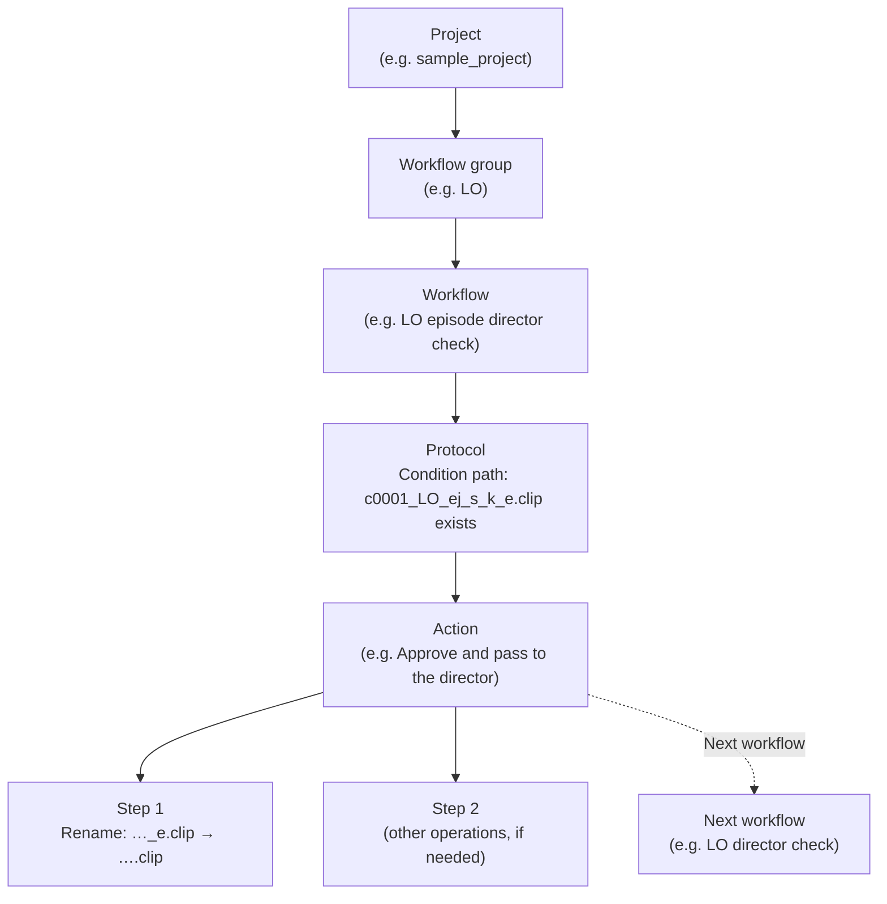
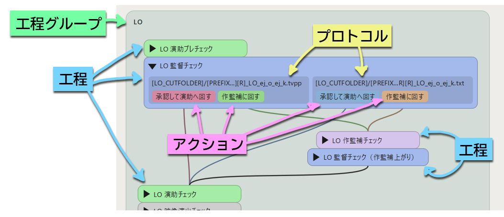

[日本語](glossary.ja.md)

# Glossary

This page explains the terms used in this manual and in the PPM user interface.
Some of them are the same words used in animation production, but PPM uses them in a slightly narrower sense.

## How a project is structured

A PPM project has the following nested structure.



- A project has several **workflow groups**.
- A workflow group has several **workflows**.
- A workflow has one or more **protocols**. A protocol defines which file must exist for a scene to be regarded as being in this workflow (the **condition path**).
- A protocol has one or more **actions**. An action is a button shown in the list.
- An action consists of **steps**, which are run in order, and the **next workflows**, to which the scene moves.


<!-- English screenshot to be made: images/en/concepts/hierarchy-in-settings.png -->

## Terms used in PPM

### Scene

The unit that makes up a production, and the unit whose progress PPM manages. It is called a "cut" in Japanese animation production.
Any string can be used as a scene name, but scenes are usually identified by a scene number such as `0001`.
In file and folder names, the scene number is used with the **prefix** defined for each project (`c` in the sample), as in `c0001`.

A **shared scene**, which combines several scenes into one, is written by joining the scene names with `_`, as in `0150_0152`.

### Episode

Used for productions that consist of several episodes, such as TV series.
In a project that uses episodes, you switch the episode to work on with the combo box at the top of the window.
It is not used for productions without episodes, such as a feature film.

### Sequence

A division used to store the files and logs of scenes in folders of 100 scenes each.
The sequence is the scene number without its last two digits (`00` for `0001` to `0099`, `01` for `0150`).
Whether to use sequences is decided for each project.

### Workflow group

A large unit of workflows, such as LO (layout), key animation, in-between, and ink and paint.
A scene normally **belongs** to one workflow group.
PPM records which workflow group each scene belongs to (see [Progress Is Managed by Files](progress-files.md)).

For each workflow group, you set the location of the **scene folder** (the folder that contains the files of the scenes in the group).

### Workflow

A stage that a scene goes through, such as "LO episode director check" or "Key animation, animation director check".
Each box in the flowchart is a workflow.
When you turn on the checkbox of a workflow in the main window, the scenes in that workflow are listed.

### Protocol

A set of a condition for determining that "a scene is in this workflow" and the actions available in that case.
Even in the same workflow, the names of the files to handle may differ between scenes made digitally and scenes made on paper.
In such a case, give a workflow several protocols.
Each protocol has a **media** type (Digital / Paper / Other).

### Condition path

The condition of a protocol, written as a file path.
The condition path of the LO episode director check in the sample is as follows.

```
[LO_CUTFOLDER]/[PREFIX][CUTNUMBER][R]_LO_ej_s_k_e.clip
```

`[LO_CUTFOLDER]` and `[CUTNUMBER]` are **macros**, which are replaced with the actual folder name and number for each scene.
For scene `0001`, the path becomes `.../c0001/LO/c0001_LO_ej_s_k_e.clip`. If this file exists, the scene is regarded as being in the LO episode director check.

### Cue file

A file that matches a condition path.
It marks that "this scene is now in this workflow".
The work file itself (such as a `.clip` file) can be the cue file, or an empty text file created just as a mark can be the cue file.

### Action

A button shown in a row of the list. It bundles the operations for moving a scene forward, such as "Approve and pass to the director".
A workflow can have several actions (for example, "Approve" and "Send back to the artist").
When you press an action, a confirmation dialog appears. When you press OK, the steps are run in order.

### Step

Each single operation run within an action.
There are several types, such as renaming, copying, creating an empty file, moving a scene to another workflow group, changing scene info tags, and writing to Google Sheets.
See [Steps](../reference/steps.md) for the list of step types.

### Next workflow

The workflow that a scene moves to after the action is run.
If an action has several next workflows, the scene moves to several workflows at the same time.

### Macro

A string enclosed in `[ ]`, such as `[ROOT]`, `[CUTNUMBER]`, or `[LO_CUTFOLDER]`. When written in a path, it is replaced with the actual value.
Some macros, such as `[CUTNUMBER]`, are built into PPM. Others, such as `[LO_CUTFOLDER]`, are **path macros** defined in each project.
See [Macros](../reference/macros.md) for the list.

### Scene info tag

A mark (tag) attached to a scene, such as "Bank", "BG Only", or "Rewind: WIP".
It is shown as a colored label next to the scene in the list.
Some tags are set by hand, and others are set and removed automatically by action steps.

### Take and retake

Asking for a scene that has gone through the workflows (for example, a scene already passed to compositing) to be corrected is called a **retake**.
When a retake is issued, the **take** number of the scene goes up by one, and the scene moves to a workflow group for retakes ("原画リテイク" (key animation retake) and so on in the sample).
The scene folders of take 2 and later have a take number such as `_t02` (when the `[TAKE]` macro is used in the folder name).

### Rewind

Sending a scene back to an earlier workflow within a workflow group (called 工程内リテイク, "in-workflow retake", in Japanese).
For example, use it to send a scene that needs corrections at the LO director check back to the LO work.
During a rewind, `_r` is added to the file name (when the `[R]` macro is used in the file name).

### Branch flow

A scene normally belongs to one workflow group, but sometimes you may want to list it in the workflows of another workflow group at the same time (for example, when the background work proceeds in parallel with the animation work).
In this case, the original workflow group is called the **main flow**, and the additional workflow group is called a **branch flow**.
A scene is added to or removed from a branch flow by action steps. A branch flow is also added when you register a scene that is in another workflow group with "Add" in "Register a scene starting from this workflow" (see [Registering Scenes](../using/registering-scenes.md)).

### Stuff folder

The folder that contains the project files, translation files, and other files used by PPM.
See [Installation](../getting-started/installation.md) and [The Stuff Folder](../administration/stuff-folder.md).

## Japanese–English terms

The Japanese and English versions of the manual and the user interface use the following terms.

| Japanese | English |
|---|---|
| カット | Scene |
| カット番号 | Scene number |
| 兼用カット | Shared scene |
| 話数 | Episode |
| シークエンス | Sequence |
| 工程グループ | Workflow group |
| 工程 | Workflow |
| プロトコル | Protocol |
| 形式（デジタル／紙／その他） | Media (Digital / Paper / Other) |
| 条件パス | Condition path |
| キューファイル | Cue file |
| アクション | Action |
| ステップ | Step |
| 次工程 | Next workflow |
| マクロ／パスマクロ | Macro / Path macro |
| カット情報 | Scene info tag |
| カットフォルダ | Scene folder |
| テイク | Take |
| リテイク | Retake |
| 工程内リテイク | Rewind |
| 主流／傍流 | Main flow / Branch flow |
| プロジェクト設定 | Project Settings |
| 環境設定 | Preferences |

---

[← Back to contents](../index.md)
