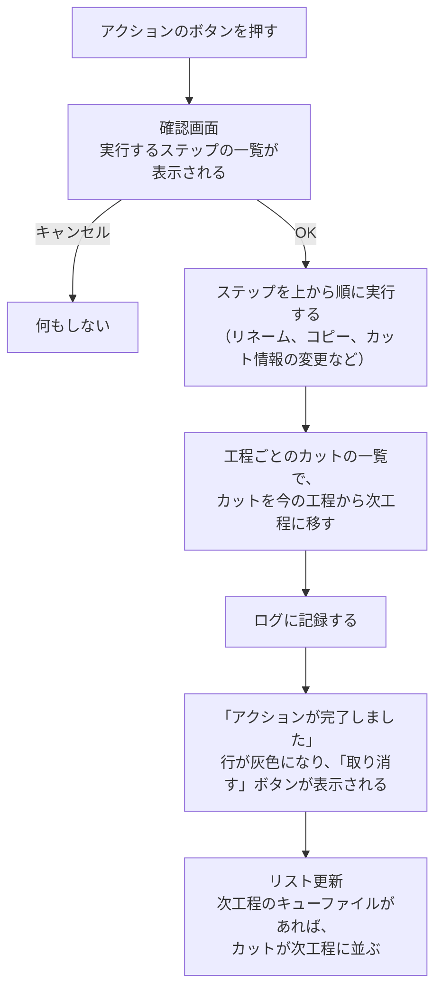

[English](scene-flow.md)

# カットが工程を流れる仕組み

このページでは、アクションのボタンを押してからカットが次の工程に並ぶまでに、PPM が何をしているかを説明します。

## 完了から次工程まで

アクションのボタンを押すと、次の順に処理が進みます。

1. **確認画面**：これから実行するステップが、実際のファイル名つきで一覧になります。
   ファイルが見つからないなど、実行できないステップがあれば、警告のアイコンが付きます。
2. **ステップの実行**：OK を押すと、ステップが上から順に実行されます。
   途中のステップが失敗すると、そこで止まり、残りのステップは実行されません（下の「失敗したとき」を参照）。
3. **次工程への移動**：ステップがすべて終わると、PPM は工程ごとのカットの一覧（[進捗はファイルで管理される](progress-files.ja.md) を参照）で、カットを今の工程から次工程に移します。
4. **ログ**：実行したアクションが、カットのログに記録されます。
5. **取り消し**：実行が終わると、その行は灰色になり、アクションのボタンの代わりに **取り消す** ボタンが表示されます。
   このボタンを押すと、実行したステップを逆の順に元に戻します。
   取り消すボタンは、**リスト更新** を押して一覧を作り直すまで表示されています。

次工程に並ぶかどうかは、最後に**次工程のキューファイルがあるかどうか**で決まります。
たとえば「承認して監督に回す」では、リネームのステップで `c0001_LO_ej_s_k.clip` ができるので、カットはすぐに LO 監督チェックに並びます。
一方、チュートリアルの「原画に移動」のように、次工程のキューファイルを作らないアクションもあります。
この場合、カットは原画の作業者がファイルを置くまで、どの工程の一覧にも表示されません。

### 失敗したとき

ステップが途中で失敗すると、警告が表示されます。
警告の **Show Details...** ボタンを押すと、どのステップで止まったかを確認できます。
失敗する前に実行されたステップは、元に戻りません。
**カットフォルダを開く** でカットフォルダを開き、ファイルの状態を確かめて、必要なら手作業で直してください。

よくある原因は、次のとおりです。

- ファイルを作業用のアプリで開いたままにしている（開いているファイルは、リネームや移動ができないことがあります）
- リネーム先やコピー先に、同じ名前のファイルがすでにある
- 共有フォルダに接続できない、または書き込みの権限がない

## 工程グループと分岐

### 工程グループをまたぐ

カットは、通常どれか1つの工程グループに所属しています。
LO から原画のように、工程グループをまたいで進むときは、アクションに**工程グループを移すステップ**を入れます。
このステップを実行すると、カットの所属が新しい工程グループに変わり、それ以降はその工程グループの工程だけでキューファイルが探されます。

### 複数の工程に同時に進む

1つのアクションに複数の次工程を設定すると、カットは同時に複数の工程に並びます。
たとえば、1つのカットを2人のチェック担当に同時に回す、という流れを作れます。
この場合、カットはそれぞれの工程のキューファイルを持ち、各工程のアクションで別々に進みます。

また、ステップで条件を調べて（カット情報や、ファイルがあるかどうか）、条件を満たすときだけ次工程を追加することもできます。
詳しくは [条件付きで次工程を追加する](../integrations/add-progress.ja.md) を参照してください。

### 傍流

カットを、所属している工程グループ（主流）のまま、別の工程グループの工程にも並べたいときは、**傍流**を使います。
傍流への追加と解除は、アクションのステップで行います。
傍流に追加されたカットは、その工程グループの工程でもキューファイルが探されます。

## リテイクと工程内リテイク

作り直しの出し方は2種類あります。

| | リテイク | 工程内リテイク |
|---|---|---|
| いつ使うか | 工程を一通り終えたカット（たとえば撮影に渡したカット）を作り直すとき | 工程グループの中で、カットを前の工程に戻すとき |
| どこから出すか | メイン画面の **リテイク** ボタン | 一覧の行にある **工程内リテイク** ボタン（アイコン） |
| カットはどこに行くか | リテイク用の工程グループ（例：原画リテイク） | 同じ工程グループの中の、選んだ工程 |
| 番号 | テイク番号が1つ増える（`_t02`、`_t03`…） | ファイル名に `_r` が付く |

### リテイク

リテイクを出すと、次のことが行われます。

1. カット情報に、新しいテイク番号と、リテイク先、コメント、日時が記録されます。
2. リテイク用の工程グループに、テイク番号の付いた新しいカットフォルダ（例：`c0001_t02`）が作られ、その中に `retake_start.txt` が置かれます。
3. カットの所属が、リテイク用の工程グループに移ります。

リテイクを出せるのは、プロジェクト設定で「リテイク発行元」をオンにした工程グループに所属しているカットです。
操作の手順は [リテイク](../using/retakes.ja.md) で説明します。

### 工程内リテイク

工程内リテイクは、工程内リテイクを使うように設定された工程グループの、形式が「デジタル」のカットで使えます。
工程内リテイクを出すと、次のことが行われます。

1. 戻し先の工程を選びます（同じ工程グループの工程から選べます）。
2. カットフォルダの今のファイルが、`old` フォルダ（2回目以降は `old2`、`old3`…）に移されます。
3. 戻し先の工程のキューファイルの目印として、名前に `_r` を付けたテキストファイルが作られます（例：`c0001_r_LO_ej_s_k_e.clip.txt`）。
4. カット情報に「工程内リテイク：作業中」が付きます。

作業者が直したファイルを `_r` の付いた名前で保存すると、カットは戻し先の工程に並びます。
その後アクションを進めると、カット情報は「工程内リテイク：チェック中」に変わります。
プロジェクト設定で指定した工程を完了すると、「工程内リテイク」のカット情報が外れます。

---

[← 目次に戻る](../index.ja.md)
