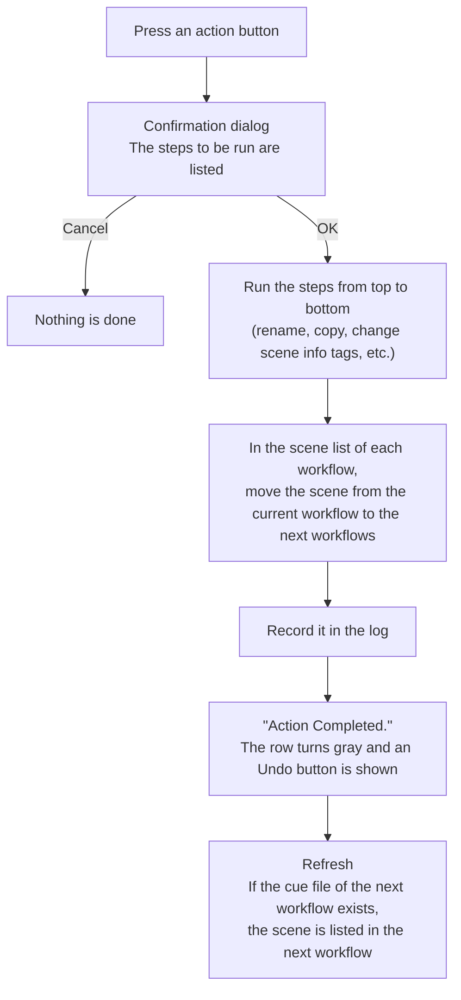

[日本語](scene-flow.ja.md)

# How Scenes Flow Through Workflows

This page explains what PPM does from the moment you press an action button until the scene is listed in the next workflow.

## From completion to the next workflow

When you press an action button, the process goes as follows.

1. **Confirmation dialog**: The steps to be run are listed with the actual file names.
   If a step cannot be run, for example because a file is not found, it is marked with a warning icon.
2. **Running the steps**: When you press OK, the steps are run from top to bottom.
   If a step fails, the process stops there, and the remaining steps are not run (see "When an action fails" below).
3. **Moving to the next workflow**: When all the steps are done, PPM moves the scene from the current workflow to the next workflows in the scene list of each workflow (see [Progress Is Managed by Files](progress-files.md)).
4. **Log**: The action is recorded in the log of the scene.
5. **Undo**: When the action is done, the row turns gray, and an **Undo** button is shown in place of the action buttons.
   Pressing this button reverts the steps in reverse order.
   The Undo button is shown until you press **Refresh** to rebuild the list.

Finally, whether the scene is listed in the next workflow depends on **whether the cue file of the next workflow exists**.
For example, in "承認して監督に回す" (approve and pass to the director), the rename step creates `c0001_LO_ej_s_k.clip`, so the scene is listed in the LO director check right away.
On the other hand, some actions, such as "原画に移動" (move to key animation) in the tutorial, do not create the cue file of the next workflow.
In that case, the scene is not shown in the list of any workflow until the key animator places the file.

### When an action fails

If a step fails, a warning is shown.
Press the **Show Details...** button in the warning to see which step stopped.
The steps run before the failure are not reverted.
Press **Open containing folder(s)** to open the scene folder, check the files, and fix them by hand if needed.

Common causes are:

- The file is still open in the application for your work (an open file sometimes cannot be renamed or moved).
- A file with the same name already exists at the destination of the rename or copy.
- The shared folder cannot be reached, or you do not have write permission.

## Workflow groups and branching

### Moving between workflow groups

A scene normally belongs to one workflow group.
To move between workflow groups, for example from LO to key animation, put a **step that moves the scene to another workflow group** in the action.
When this step is run, the scene belongs to the new workflow group, and from then on, cue files are only looked for in the workflows of that workflow group.

### Moving to several workflows at once

If you set several next workflows for an action, the scene is listed in several workflows at the same time.
For example, you can pass a scene to two checkers at the same time.
In this case, the scene has a cue file for each workflow and moves forward separately with the actions of each workflow.

You can also check a condition in a step (a scene info tag, or whether a file exists) and add a next workflow only when the condition is met.
See [Adding Next Workflows Conditionally](../integrations/add-progress.md) for details.

### Branch flows

To list a scene in the workflows of another workflow group while it still belongs to its own workflow group (the main flow), use a **branch flow**.
A scene is added to or removed from a branch flow by action steps.
For a scene added to a branch flow, cue files are also looked for in the workflows of that workflow group.

## Retakes and rewinds

There are two ways to ask for a scene to be redone.

| | Retake | Rewind |
|---|---|---|
| When to use | To redo a scene that has gone through the workflows (for example, a scene already passed to compositing) | To send a scene back to an earlier workflow within a workflow group |
| Where to issue it | The **Retake** button in the main window | The **Rewind** button (icon) in a row of the list |
| Where the scene goes | A workflow group for retakes (e.g. 原画リテイク, key animation retake) | The workflow you choose in the same workflow group |
| Numbering | The take number goes up by one (`_t02`, `_t03`, ...) | `_r` is added to the file name |

### Retakes

When you issue a retake, the following is done.

1. The new take number, the destination of the retake, a comment, and the date and time are recorded in the scene info.
2. A new scene folder with the take number (e.g. `c0001_t02`) is created in the workflow group for retakes, and `retake_start.txt` is placed in it.
3. The scene moves to the workflow group for retakes.

A retake can be issued for a scene that belongs to a workflow group with "Is Retake Source" turned on in the project settings.
The procedure is explained in [Retakes](../using/retakes.md).

### Rewinds

A rewind can be used for a scene whose media is "Digital", in a workflow group set to use rewinds.
When you rewind a scene, the following is done.

1. Choose the workflow to send the scene back to (from the workflows in the same workflow group).
2. The current files in the scene folder are moved to an `old` folder (`old2`, `old3`, ... from the second time).
3. A text file with `_r` in its name is created as a mark for the cue file of the destination workflow (e.g. `c0001_r_LO_ej_s_k_e.clip.txt`).
4. The scene info tag "Rewind: WIP" is attached to the scene.

When the artist saves the corrected file with a name containing `_r`, the scene is listed in the destination workflow.
When the scene then moves forward with an action, the tag changes to "Rewind: Checking".
When the scene completes the workflow specified in the project settings, the "Rewind" tag is removed.

---

[← Back to contents](../index.md)
