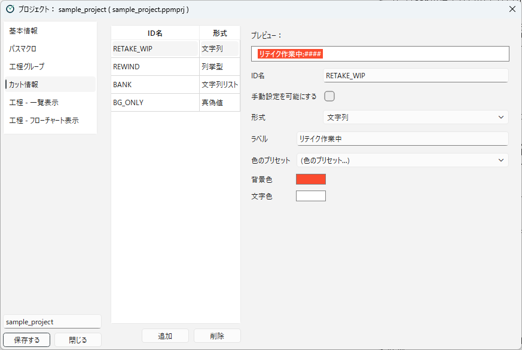

[English](info-tags.md)

# カット情報

**カット情報**は、「バンク」「BG Only」「工程内リテイク：作業中」のように、カットに付ける印です。
スタッフがカット情報を見たり付けたりする方法は、[カット情報](../using/scene-info.ja.md)（3章）で説明しています。
このページでは、プロジェクトで使うカット情報を用意する方法を説明します。

## カット情報の種類

カット情報には、次の4つの**形式**があります。

| 形式 | 内容 | 表示 | サンプルの例 |
|---|---|---|---|
| **真偽値** | 付いているか、付いていないかだけを表します。 | ラベルだけ | BG Only（`BG_ONLY`） |
| **文字列** | 1つの値を持ちます。 | 「ラベル:値」 | リテイク作業中（`RETAKE_WIP`） |
| **文字列リスト** | 複数の値を持ちます。 | 「ラベル:値, 値」 | バンク（`BANK`） |
| **列挙型** | あらかじめ決めた値のどれか1つを持ちます。値ごとに、ラベルと色を決められます。 | 値ごとのラベル | 工程内リテイク（`REWIND`。値は `WIP` と `BackOnTrack`） |

3章では、それぞれ「オン／オフ」「文字列」「文字列のリスト」「選択肢」と呼んでいます。

## カット情報をつくる

**カット情報** のカテゴリで、カット情報を登録します。
左側にカット情報の一覧、右側に選んだカット情報の詳細が表示されます。

1. **追加** を押します。「新規カット情報」という名前のカット情報が追加されます。
2. 右側で、詳細を入れます。
3. 使わなくなったカット情報は、一覧で選んで **削除** を押します。

| 項目 | 内容 |
|---|---|
| **プレビュー** | カットの一覧の「情報」の列で、どのように表示されるかを示します。 |
| **ID名** | カット情報の内部の名前です（例：`BANK`）。カット情報のファイルには、この名前で記録されます。ステップでカット情報を指定するときも、この名前を使います。 |
| **手動設定を可能にする** | オンにすると、スタッフが **カット登録** の画面で付けたり外したりできます。オフにすると、アクションのステップでだけ付け外しされます。 |
| **形式** | 上の4つの形式から選びます。 |
| **ラベル** | 画面に表示する名前です（例：`バンク`）。 |
| **色のプリセット** | 背景色と文字色の組み合わせを、一覧から選べます。 |
| **背景色**、**文字色** | ラベルの色です。ボタンを押すと、色を選べます。 |

**形式** を変えると、ラベルと色は初期の状態に戻ります。

### 列挙型の値

形式が **列挙型** のときは、**ラベル** や色の代わりに、**値** の一覧が表示されます。
**値を追加** で値を増やし、値ごとに次の列を入れます。

| 列 | 内容 |
|---|---|
| **値** | 内部の値です（例：`WIP`）。ステップや条件分岐では、この値を使います。 |
| **ラベル** | その値のときに表示する名前です（例：`工程内リテイク：作業中`）。 |
| **背景**、**文字** | その値のときのラベルの色です。 |
| **プリセット** | 色の組み合わせを、一覧から選べます。 |

## PPM の機能が使うカット情報

次の ID名のカット情報は、PPM の機能が名前で使います。
これらの機能を使う場合は、同じ ID名でカット情報を用意してください。

| ID名 | 使う機能 | 用意するもの |
|---|---|---|
| `REWIND` | 工程内リテイク（[カットが工程を流れる仕組み](../concepts/scene-flow.ja.md) を参照） | 形式を **列挙型** にして、値 `WIP`（作業中）と `BackOnTrack`（チェック中）を作ります。**手動設定を可能にする** はオフにします。 |
| `BANK` | Google スプレッドシートへの書き込み（[Google スプレッドシート連携](../integrations/google-spreadsheet.ja.md) を参照） | 形式を **文字列リスト** にします。値に入っているカット（バンクの元のカット）の行にも、同じ内容が書き込まれます。 |
| `RETAKE_WIP` | リテイク（[リテイク](../using/retakes.ja.md) を参照） | 形式を **文字列** にします。リテイクを出すと、リテイク先の工程グループの名前を値として、自動で付きます。外すには、リテイクの作業が終わったときに実行するアクションに、「カット情報を登録」ステップ（カット情報名 `RETAKE_WIP`、値は空）を入れます（サンプルでは、「原画リテイク 演出チェック」の「承認して監督に回す」など）。**手動設定を可能にする** はオフにします。 |

サンプルプロジェクトには、この3つが入っています。
サンプルプロジェクトを元にプロジェクトを作れば、そのまま使えます。

## カット情報を使う

カット情報は、表示するだけでなく、アクションの中で使えます。

- **付ける・外す**：「カット情報を登録」ステップで、アクションの実行時にカット情報を付けたり外したりします。たとえば、リテイクの工程に入ったときに「リテイク作業中」を付け、上がったときに外す、といった使い方です。
- **条件分岐**：「条件分岐：カット情報」ステップで、カット情報の値によって、実行するステップを変えます。たとえば、「BG Only」が付いているカットだけ、別の工程にも回す、といった使い方です。

条件分岐の「条件となる値」には、次のように書きます。

- 真偽値：`1`（空のままでも、値が真かどうかで判定します）
- 列挙型：値（例：`WIP`）
- 文字列：値そのもの

空のままにすると、真偽値のカット情報は値が真のとき、それ以外のカット情報は付いているときに「真の場合」になります。

それぞれのステップの詳しい設定は、[ステップ一覧](../reference/steps.ja.md) で説明します。
条件分岐で次の工程を追加する方法は、[条件付きで次工程を追加する](../integrations/add-progress.ja.md) で説明します。

---

[← 目次に戻る](../index.ja.md)
