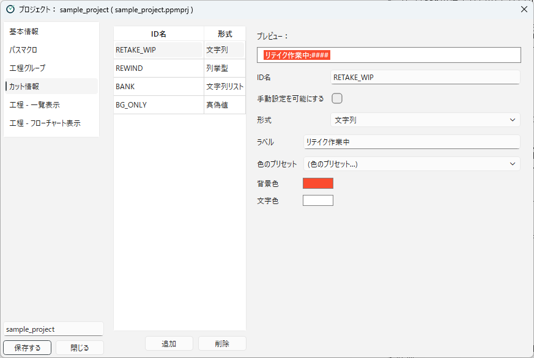

[日本語](info-tags.ja.md)

# Scene Info Tags

**Scene info tags** are marks attached to a scene, such as "Bank", "BG Only", or "Rewind: WIP".
How staff view and attach scene info tags is explained in [Scene Info Tags](../using/scene-info.md) (chapter 3).
This page explains how to prepare the scene info tags used in a project.

## Types of scene info tags

Scene info tags have the following four **types**.

| Type | Contents | Display | Example in the sample |
|---|---|---|---|
| **Bool** | Only shows whether it is attached or not. | The label only | BG Only (`BG_ONLY`) |
| **String** | Has one value. | "label:value" | リテイク作業中, retake in progress (`RETAKE_WIP`) |
| **String List** | Has several values. | "label:value, value" | バンク, bank (`BANK`) |
| **Enum** | Has one of the predefined values. Each value can have its own label and color. | The label of the value | 工程内リテイク, rewind (`REWIND`; values `WIP` and `BackOnTrack`) |

Chapter 3 calls them "on/off", "string", "string list", and "choice".

## Creating scene info tags

Register scene info tags in the **Info Tags** category.
The list of scene info tags is shown on the left, and the details of the selected one on the right.

<!-- English screenshot to be made: images/en/designing/info-tags.png -->

1. Press **Add**. A scene info tag named "NEW_TAG" is added.
2. Enter the details on the right.
3. To delete a scene info tag you no longer use, select it in the list and press **Remove**.

| Item | Contents |
|---|---|
| **Preview** | Shows how it is displayed in the "Information" column of the scene list. |
| **ID Name** | The internal name of the scene info tag (e.g. `BANK`). Scene info files record the tag under this name. Steps also use this name to specify the tag. |
| **Can Manually Set** | When on, staff can attach and remove it in the **Register** dialog. When off, it is attached and removed only by action steps. |
| **Type** | Choose one of the four types above. |
| **Label** | The name shown on the screen (e.g. `Bank`). |
| **Color Preset** | Choose a combination of background and text colors from a list. |
| **Background Color**, **Text Color** | The colors of the label. Press the button to choose a color. |

If you change the **Type**, the label and colors are reset.

### Values of an Enum

When the type is **Enum**, a list of **Values** is shown instead of the **Label** and colors.
Add values with **Add Value**, and fill in the following columns for each value.

| Column | Contents |
|---|---|
| **Value** | The internal value (e.g. `WIP`). Steps and conditional branches use this value. |
| **Label** | The name shown for the value (e.g. `Rewind: WIP`). |
| **Background**, **Text** | The colors of the label for the value. |
| **Preset** | Choose a color combination from a list. |

## Scene info tags used by PPM features

PPM features use scene info tags with the following ID names.
To use these features, prepare scene info tags with the same ID names.

| ID name | Feature | What to prepare |
|---|---|---|
| `REWIND` | Rewind (see [How Scenes Flow Through Workflows](../concepts/scene-flow.md)) | Set the type to **Enum** and create the values `WIP` (in progress) and `BackOnTrack` (checking). Turn **Can Manually Set** off. |
| `BANK` | Writing to Google Spreadsheet (see [Google Spreadsheet Integration](../integrations/google-spreadsheet.md)) | Set the type to **String List**. The same contents are also written to the rows of the scenes in its values (the bank source scenes). |
| `RETAKE_WIP` | Retakes (see [Retakes](../using/retakes.md)) | Set the type to **String**. When a retake is issued, it is attached automatically, with the name of the destination workflow group as its value. To remove it, put a "Set Scene Info Tag" step (Info Name `RETAKE_WIP`, empty value) in the action that runs when the retake work is finished (in the sample, "承認して監督に回す" (approve and send to the director) of "原画リテイク 演出チェック" (key animation retake, episode director check), and so on). Turn **Can Manually Set** off. |

The sample project includes all three.
If you create your project from the sample project, you can use them as they are.

## Using scene info tags

Scene info tags are not only displayed; they can be used in actions.

- **Attaching and removing**: The "Set Scene Info Tag" step attaches or removes a scene info tag when the action runs. For example, attach "retake in progress" when a scene enters a retake workflow, and remove it when the work is up.
- **Conditional branches**: The "Conditional Branch By Info Tag" step changes the step to run depending on the value of a scene info tag. For example, send only scenes with "BG Only" to another workflow as well.

Write the "Condition Value" of a conditional branch as follows:

- Bool: `1` (you can also leave it empty; then the value of the tag is checked)
- Enum: the value (e.g. `WIP`)
- String: the value itself

If you leave it empty, "If True" is chosen when a Bool tag is true, or when any other tag is set.

The settings of each step are explained in [Steps](../reference/steps.md).
How to add next workflows with a conditional branch is explained in [Adding Next Workflows Conditionally](../integrations/add-progress.md).

---

[← Back to contents](../index.md)
