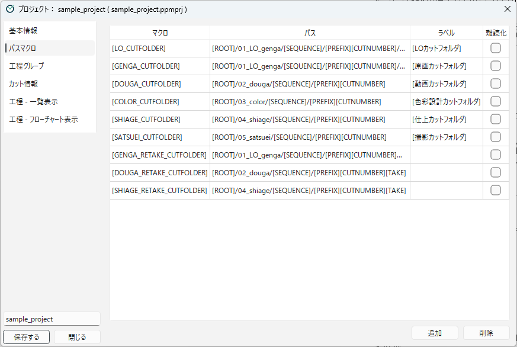

[English](path-macros.md)

# パスマクロ

## パスマクロとは

**パスマクロ**は、よく使うフォルダの場所に名前を付けたものです。
条件パスやステップのパスの中に `[LO_CUTFOLDER]` のように書くと、登録したパスに置き換えられます。

たとえばサンプルプロジェクトでは、LO のカットフォルダを次のように登録しています。

| マクロ | パス |
|---|---|
| `[LO_CUTFOLDER]` | `[ROOT]/01_LO_genga/[SEQUENCE]/[PREFIX][CUTNUMBER]/LO` |

これで、LO の工程の条件パスは `[LO_CUTFOLDER]/[PREFIX][CUTNUMBER][R]_LO_ej_s_k_e.clip` のように短く書けます。
カットフォルダの場所を変えたくなったときも、パスマクロを1か所直すだけで済みます。

## パスマクロをつくる

**パスマクロ** のカテゴリで、マクロを登録します。

1. **追加** を押します。`[新規マクロ]` という行が追加されます。
2. 各列を入れます。セルをダブルクリックすると編集できます。
3. 使わなくなったマクロは、行を選んで **削除** を押します。

| 列 | 内容 |
|---|---|
| **マクロ** | パスの中に書く名前です。`[` と `]` で囲みます（例：`[LO_CUTFOLDER]`）。 |
| **パス** | 置き換えられるパスです。下の「パスの中で使える組み込みのマクロ」を使えます。 |
| **ラベル** | マクロの説明です（例：`[LOカットフォルダ]`）。 |
| **難読化** | オンにすると、パスを隠します（下を参照）。 |

パスを入力する欄では、`[` を入力すると、登録したマクロと組み込みのマクロの候補が表示されます。
登録されているマクロは色付きで表示されるので、打ち間違いに気付けます。
この表の **パス** の列でも、`[` を入力すると、パスの中で使える組み込みのマクロが候補に出ます。パスマクロの中に別のパスマクロを書いても置き換えられないので、パスマクロは候補に出ません。

### パスの中で使える組み込みのマクロ

パスマクロのパスや、条件パス、ステップのパスでは、次の組み込みのマクロを使えます。

| マクロ | 置き換えられるもの |
|---|---|
| `[ROOT]` | プロジェクトのルートフォルダ |
| `[PREFIX]` | カット番号の接頭辞 |
| `[CUTNUMBER]` | カット番号 |
| `[SEQUENCE]` | シークエンス（「100カットごとにまとめる」がオンのとき） |
| `[EPISODE]` | 話数の名前（「話数あり」のとき） |
| `[USER_NAME]` | 環境設定のユーザー名 |
| `[TAKE]` など | テイク番号（[工程グループ](workflow-groups.ja.md) の「テイク表記」を参照） |
| `[R]` | 工程内リテイク中の印 `_r`（[工程グループ](workflow-groups.ja.md) の「テイク表記」を参照） |

すべてのマクロの一覧は、[マクロ一覧](../reference/macros.ja.md) にあります。

### パスマクロを使うときの決まり

- 1つのパスの中で使えるパスマクロは、1つだけです。2つ以上書くと、1つしか置き換えられません。
- パスマクロのパスの中に、別のパスマクロは書けません。組み込みのマクロ（`[ROOT]` など）は書けます。

### 難読化

**難読化** をオンにすると、パスが暗号化されて保存され、プロジェクト設定の画面にも表示されなくなります。
スタッフに見せたくないフォルダの場所（社外の受け渡し用のフォルダなど）に使います。

- オンにするときは、確認のメッセージが表示されます。パスが空のときはオンにできません。
- オンにした後は、パスの欄に「-- このパスは難読化されています --」と表示され、編集できません。
- オフに戻すと、パスは消えます。もう一度入れ直してください。
- 難読化したパスは、アクションの確認画面にも表示されません。

## 標準カットフォルダのマクロ

各工程グループには、その工程グループのカットフォルダを表すパスマクロを1つ選んでおきます（[工程グループ](workflow-groups.ja.md) の「標準カットフォルダのマクロ」）。
サンプルプロジェクトでは、LO には `[LO_CUTFOLDER]`、原画には `[GENGA_CUTFOLDER]` を選んでいます。

標準カットフォルダのマクロは、次のときに使われます。

- **タイムシートを開く** ボタンで、タイムシート（XDTS）を探すとき
- リテイクを出したときに、テイク番号の付いたカットフォルダを作るとき

リテイク用の工程グループのマクロには、テイク番号のマクロ `[TAKE]` を入れておきます。
サンプルプロジェクトでは、原画リテイクのマクロを `[ROOT]/01_LO_genga/[SEQUENCE]/[PREFIX][CUTNUMBER][TAKE]/genga` としているので、カット `c0001` のテイク2のフォルダは `c0001_t02/genga` になります。

前のテイクのフォルダを指すパスマクロ（サンプルでは `[GENGA_PREV_EXISTING_TAKE_CUTFOLDER]` など）には、`[PREV_EXISTING_TAKE]` を使います。前のテイクのデータを切り分けるサブフォルダの名前には、`[TAKE-1]` を使います（[マクロ一覧](../reference/macros.ja.md) の「前のテイクを指すマクロ」を参照）。

---

[← 目次に戻る](../index.ja.md)
