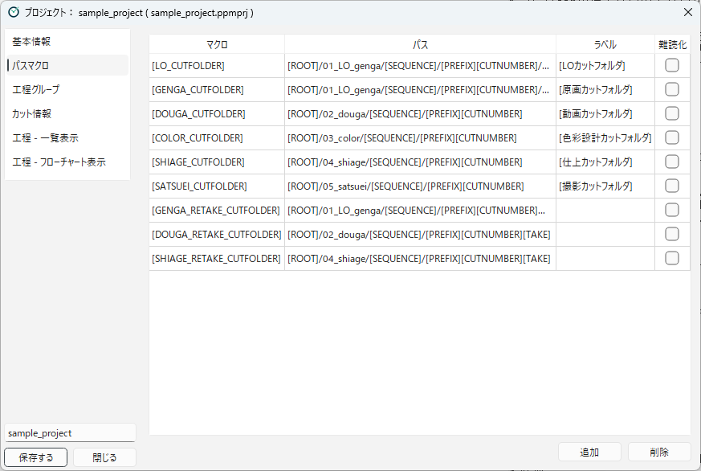

[日本語](path-macros.ja.md)

# Path Macros

## What path macros are

A **path macro** is a name given to a frequently used folder location.
When you write it in a condition path or a step path, like `[LO_CUTFOLDER]`, it is replaced with the registered path.

For example, the sample project registers the scene folder of LO as follows.

| Macro | Path |
|---|---|
| `[LO_CUTFOLDER]` | `[ROOT]/01_LO_genga/[SEQUENCE]/[PREFIX][CUTNUMBER]/LO` |

With this, the condition paths of the LO workflows can be written briefly, like `[LO_CUTFOLDER]/[PREFIX][CUTNUMBER][R]_LO_ej_s_k_e.clip`.
If you want to change the location of the scene folder later, you only need to fix the path macro in one place.

## Creating path macros

Register macros in the **Path Macros** category.

<!-- English screenshot to be made: images/en/designing/path-macros.png -->

1. Press **Add**. A row named `[NEW_MACRO]` is added.
2. Fill in each column. Double-click a cell to edit it.
3. To delete a macro you no longer use, select its row and press **Remove**.

| Column | Contents |
|---|---|
| **Macro** | The name written in paths. Enclose it in `[` and `]` (e.g. `[LO_CUTFOLDER]`). |
| **Path** | The path it is replaced with. You can use the built-in macros listed below. |
| **Label** | A description of the macro (e.g. `[LO cutfolder]`). |
| **Obfuscate** | When on, the path is hidden (see below). |

In fields where you enter a path, typing `[` shows the registered macros and built-in macros as candidates.
Known macros are shown in color, so you can notice typing mistakes.
In the **Path** column of this table, too, typing `[` shows the built-in macros you can use in paths as candidates. Path macros are not shown, because a path macro written in another path macro is not replaced.

### Built-in macros you can use in paths

In the paths of path macros, condition paths, and step paths, you can use the following built-in macros.

| Macro | Replaced with |
|---|---|
| `[ROOT]` | The project root folder |
| `[PREFIX]` | The scene number prefix |
| `[CUTNUMBER]` | The scene number |
| `[SEQUENCE]` | The sequence (when "Group Scenes by 100" is on) |
| `[EPISODE]` | The episode name (when "Has Episodes" is on) |
| `[USER_NAME]` | The user name in Preferences |
| `[TAKE]` and others | The take number (see "Take Notation" in [Workflow Groups](workflow-groups.md)) |
| `[R]` | The rewind mark `_r` (see "Take Notation" in [Workflow Groups](workflow-groups.md)) |

All macros are listed in [Macros](../reference/macros.md).

### Rules for using path macros

- Only one path macro can be used in one path. If you write two or more, only one of them is replaced.
- You cannot write a path macro in the path of another path macro. You can write built-in macros (such as `[ROOT]`) there.

### Obfuscate

When **Obfuscate** is on, the path is saved in encrypted form and is no longer shown in the Project Settings dialog.
Use it for folder locations you do not want to show to staff (such as a folder for exchanging files with outside companies).

- A confirmation message is shown when you turn it on. It cannot be turned on while the path is empty.
- After it is turned on, the path field shows "-- This path is obfuscated --" and cannot be edited.
- When you turn it off again, the path is cleared. Enter it again.
- Obfuscated paths are not shown in the action confirmation dialog either.

## Standard cut folder macro

For each workflow group, choose one path macro that represents the scene folder of that workflow group ("Standard Cut Folder Macro" in [Workflow Groups](workflow-groups.md)).
In the sample project, `[LO_CUTFOLDER]` is chosen for LO and `[GENGA_CUTFOLDER]` for key animation.

The standard cut folder macro is used in the following cases:

- When looking for the timesheet (XDTS) for the **Open XDTS** button
- When creating the scene folder with the take number after a retake is issued

Put the take number macro `[TAKE]` in the macro of a workflow group for retakes.
In the sample project, the macro for key animation retakes is `[ROOT]/01_LO_genga/[SEQUENCE]/[PREFIX][CUTNUMBER][TAKE]/genga`, so the folder for take 2 of scene `c0001` is `c0001_t02/genga`.

For path macros that point to a previous take's folder (such as `[GENGA_PREV_EXISTING_TAKE_CUTFOLDER]` in the sample), use `[PREV_EXISTING_TAKE]`. For the name of the subfolder that keeps the previous take's data, use `[TAKE-1]` (see "Macros for previous takes" in [Macros](../reference/macros.md)).

---

[← Back to contents](../index.md)
