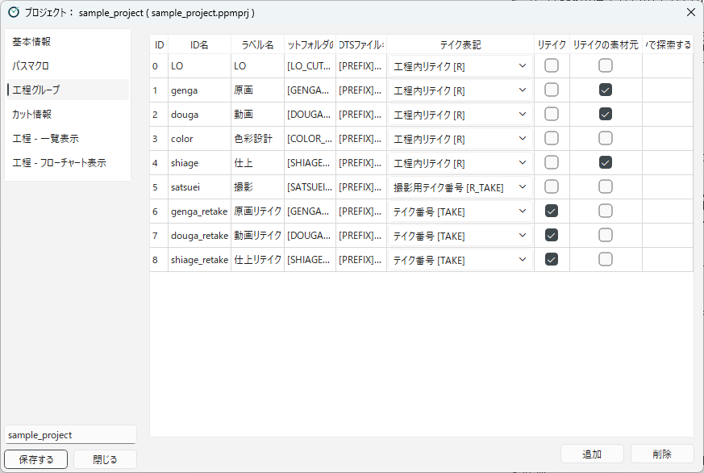

[English](workflow-groups.md)

# 工程グループ

**工程グループ**は、LO、原画、動画のような、工程のまとまりです。
カットは、通常どれか1つの工程グループに所属し、その工程グループの工程だけでキューファイルが探されます（[進捗はファイルで管理される](../concepts/progress-files.ja.md) を参照）。

## 工程グループをつくる

**工程グループ** のカテゴリで、工程グループを登録します。

1. **追加** を押します。新しい行が追加され、**ID名** の欄が編集できる状態になります。
2. 各列を入れます。セルをダブルクリックすると編集できます。
3. 使わなくなった工程グループは、行を選んで **削除** を押します。

工程が属している工程グループは、削除できません。**削除** を押すと、属している工程の一覧が表示されます。
先に工程を削除するか、別の工程グループに移してから、工程グループを削除してください。

工程グループを指定しているステップ（**工程グループを移動**、**傍流工程を開始**、**傍流工程を終了**）がある場合は、削除してよいかを確認するメッセージが表示されます。
削除した後は、それらのステップで、別の工程グループを指定し直してください。

工程グループは、**工程 - フローチャート表示** でも作れます（[工程を設計する](workflows.ja.md) を参照）。
フローチャート表示で工程グループの枠をダブルクリックすると、右側にこの一覧が表示され、その工程グループの行が選ばれます。

| 列 | 内容 |
|---|---|
| **ID** | 工程グループの番号です。追加すると、空いている番号が自動で付きます。0以上の整数で、ほかの工程グループと重ならないようにします。 |
| **ID名** | 工程グループの内部の名前です（例：`LO`、`genga`）。記録のファイル名などに使われます（下を参照）。 |
| **ラベル名** | 画面に表示する名前です（例：`原画`）。 |
| **標準カットフォルダのマクロ** | この工程グループのカットフォルダを表すパスマクロです（例：`[GENGA_CUTFOLDER]`）。[パスマクロ](path-macros.ja.md) で登録したマクロを、そのまま書きます。 |
| **XDTSファイル名** | カットフォルダの中にあるタイムシートのファイル名です（下を参照）。 |
| **テイク表記** | この工程グループで、テイク番号と工程内リテイクをどう扱うかです（下を参照）。 |
| **リテイク** | リテイク用の工程グループのときにオンにします（下の「リテイク用の工程グループ」を参照）。 |
| **リテイク発行元** | リテイクを出せるカットの工程グループのときにオンにします（同上）。 |
| **「開く」ボタンで探索するサブフォルダ** | 設定すると、**開く** ボタンで、キューファイルのフォルダの中のこのサブフォルダにある作業ファイル（`.clip`、`.tvpp`、`.tnz`）を開きます。`[PREFIX]`、`[CUTNUMBER]` などのマクロを使えます。空のときは、キューファイルのフォルダを開きます。 |

### 工程グループの順番

工程グループは、**ID の小さい順**に並びます。
メイン画面の一覧表示や、リテイク画面のリテイク先のボタンも、この順番です。
順番を変えたいときは、ID を書き換えます。
ID を書き換えると、その工程グループの工程や、工程グループを指定するステップ（**工程グループを移動** など）も、新しい ID に自動で付け替えられます。
カットの記録は、ID ではなく ID名 で管理しているので、こちらも影響を受けません。

### ID名

ID名は、次のところで使われます。

- プロジェクト情報フォルダにある、工程グループの所属の記録（`progress/LO.ini` など）と、工程ごとのカットの一覧（`progress_cache/LO_details.ini` など）のファイル名
- リテイクの記録（リテイク先）

そのため、カットを登録した後で ID名を変えると、それまでの記録が見つからなくなります（[運用中に設計を変えるときの注意](changing-in-production.ja.md) を参照）。

### XDTS ファイル名

**タイムシートを開く** ボタンで開くタイムシートのファイル名です。
PPM は、標準カットフォルダと、その工程のキューファイルがあるフォルダの中で、このファイルを探します。キューファイルのフォルダも探すので、チェック担当ごとのフォルダへカットフォルダを移して受け渡す場合でも、タイムシートを開けます。同じ名前のファイルが両方にある場合は、標準カットフォルダのものを使います。
`[PREFIX]`、`[CUTNUMBER]`、`[SEQUENCE]`、`[EPISODE]` などのマクロを使えます（例：`[PREFIX][CUTNUMBER]_genga_ts.xdts`）。
`[` を入力すると、XDTS ファイル名で使えるマクロが候補に出ます。使えるマクロだけが色付きで表示されます。

XDTS ファイル名でだけ使える、次のマクロもあります。

- `[GENGA_OR_DOUGA]`：`douga` と `genga` のうち、ファイルがある方になります。動画のタイムシートができるまでは原画のタイムシートを開く、といった使い方ができます（例：`[PREFIX][CUTNUMBER]_[GENGA_OR_DOUGA]_ts.xdts`）。
- `[R_TAKE]`：テイク表記が「撮影用テイク番号 [R_TAKE]」の工程グループで、撮影用のテイクの印になります。

兼用カット（`0010_0011` など）では、`0010`、`0011`、`0010_0011` のそれぞれの名前でタイムシートを探し、見つかったものをメニューから選べます。

## テイク表記

**テイク表記** は、この工程グループの工程でキューファイルを探すときに、テイク番号や工程内リテイクの印をどう扱うかを決めます。

| テイク表記 | 条件パスの中で置き換えられるマクロ | 置き換えられるもの |
|---|---|---|
| **なし** | なし | ― |
| **工程内リテイク [R]** | `[R]` | 工程内リテイク中は `_r`、それ以外は空 |
| **テイク番号 [TAKE]** | `[TAKE]` | テイク1は空、テイク2から `_t02`、`_t03`… |
| **撮影用テイク番号 [R_TAKE]** | `[R_TAKE]` | テイク1は空、テイク2は `_r`、テイク3から `_r02`、`_r03`… |

キューファイルを探すときに置き換えられるのは、選んだテイク表記のマクロだけです。
たとえば「工程内リテイク [R]」の工程グループの条件パスに `[TAKE]` を書いても、置き換えられないので、ファイルは見つかりません。

テイク表記は、ほかに次のことにも関わります。

- **工程内リテイク**：「工程内リテイク [R]」の工程グループでだけ、形式が「デジタル」の行に **工程内リテイク** のボタンが表示されます（[カットに対する操作](../using/scene-operations.ja.md) を参照）。
- **一覧の表示**：カットの一覧では、カット名にテイク表記の印が付いて表示されます（例：「テイク番号 [TAKE]」のテイク2なら `0001_t02`、「工程内リテイク [R]」の工程内リテイク中なら `0001_r`）。

サンプルプロジェクトでは、LO・原画・動画・仕上は「工程内リテイク [R]」、リテイク用の工程グループは「テイク番号 [TAKE]」、撮影は「撮影用テイク番号 [R_TAKE]」です。

## リテイク用の工程グループ

リテイクの流れを作るには、リテイク用の工程グループを用意します。
リテイクの仕組みは [カットが工程を流れる仕組み](../concepts/scene-flow.ja.md)、操作は [リテイク](../using/retakes.ja.md) で説明しています。

- **リテイク**：オンにした工程グループが、リテイク画面の **リテイク先** にボタンで並びます（サンプルでは原画リテイク、動画リテイク、仕上リテイク）。
- **リテイク発行元**：オンにした工程グループに所属しているカットに、リテイクを出せます（サンプルでは撮影）。

リテイク用の工程グループは、次のように設定しておきます。

1. **標準カットフォルダのマクロ** に、`[TAKE]` を含むパスマクロを選びます（[パスマクロ](path-macros.ja.md) を参照）。リテイクを出すと、このフォルダ（例：`c0001_t02/genga`）が作られ、その中に `retake_start.txt` が置かれます。
2. **テイク表記** を「テイク番号 [TAKE]」にします。
3. 最初の工程の条件パスを、`retake_start.txt` に当てはまるようにします（例：`[GENGA_RETAKE_CUTFOLDER]/retake_start.txt`）。

### 所属の切り替わり方

カットを工程グループに登録したり、工程グループを移したりすると、カットはそれまでの工程グループから外れます。
このとき、外れるのは次の範囲の工程グループです。

- 通常の工程グループに登録したとき：ほかの通常の工程グループ
- リテイク用の工程グループに登録したとき：ほかのリテイク用の工程グループと、リテイク発行元の工程グループ

そのため、リテイクを出しても、リテイク用でもリテイク発行元でもない工程グループ（サンプルでは LO・原画・動画・色彩設計・仕上）の所属は残ります。

---

[← 目次に戻る](../index.ja.md)
