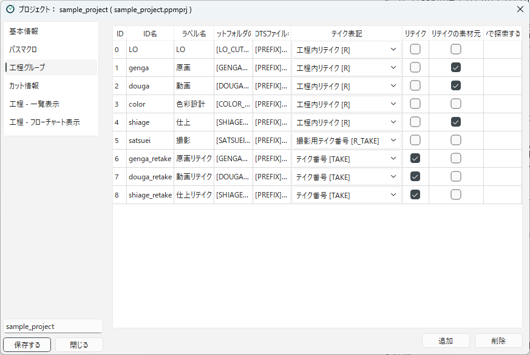

[日本語](workflow-groups.ja.md)

# Workflow Groups

A **workflow group** is a group of workflows, such as LO, key animation, or in-between.
A scene usually belongs to one workflow group, and cue files are looked for only in the workflows of that workflow group (see [Progress Is Managed by Files](../concepts/progress-files.md)).

## Creating workflow groups

Register workflow groups in the **Workflow Groups** category.

<!-- English screenshot to be made: images/en/designing/workflow-groups.png -->

1. Press **Add**. A new row is added, and its **ID Name** cell is ready for editing.
2. Fill in each column. Double-click a cell to edit it.
3. To delete a workflow group you no longer use, select its row and press **Remove**.

A workflow group that has workflows cannot be deleted. When you press **Remove**, the list of its workflows is shown.
Delete the workflows or move them to another workflow group first, and then delete the workflow group.

If some steps specify the workflow group (**Move Flow Group**, **Start Branch Flow**, **End Branch Flow**), a message asks whether to delete it.
After deleting it, specify another workflow group in those steps.

Workflow groups can also be created in **Workflows - Flowchart** (see [Designing Workflows](workflows.md)).
In the flowchart, double-click the frame of a workflow group to show this list on the right, with the row of that workflow group selected.

| Column | Contents |
|---|---|
| **ID** | The number of the workflow group. A free number is assigned automatically when you add one. Use a non-negative integer that no other workflow group uses. |
| **ID Name** | The internal name of the workflow group (e.g. `LO`, `genga`). Used in the names of record files and elsewhere (see below). |
| **Label Name** | The name shown on the screen (e.g. `原画`, key animation). |
| **Standard Cut Folder Macro** | The path macro that represents the scene folder of this workflow group (e.g. `[GENGA_CUTFOLDER]`). Write a macro registered in [Path Macros](path-macros.md) as it is. |
| **XDTS File Name** | The file name of the timesheet in the scene folder (see below). |
| **Take Notation** | How this workflow group handles take numbers and rewinds (see below). |
| **Is Retake Group** | Turn on for a workflow group for retakes (see "Workflow groups for retakes" below). |
| **Is Retake Source** | Turn on for a workflow group whose scenes can be retaken (same as above). |
| **Subfolder For Open Button** | If set, the **Open** button opens the work file (`.clip`, `.tvpp`, `.tnz`) in this subfolder of the cue file's folder. Macros such as `[PREFIX]` and `[CUTNUMBER]` can be used. If empty, the cue file's folder is opened. |

### Order of workflow groups

Workflow groups are listed in **ascending order of ID**.
The list view in the main window and the Pass to buttons in the retake dialog also follow this order.
To change the order, change the ID.
When you change the ID, the workflows of that workflow group and the steps that specify the workflow group (Move Flow Group, and so on) follow the new ID automatically.
The records of scenes are not affected either, because they use the ID name, not the ID.

### ID name

The ID name is used in the following places:

- The file names of the workflow group membership record (such as `progress/LO.ini`) and the list of scenes in each workflow (such as `progress_cache/LO_details.ini`) in the project info folder
- The retake records (the destination of a retake)

Therefore, if you change the ID name after scenes have been registered, the existing records will no longer be found (see [Changing the Design During Production](changing-in-production.md)).

### XDTS file name

The file name of the timesheet opened with the **Open XDTS** button.
PPM looks for this file in the standard cut folder and in the folder of the cue file of the workflow. Because the folder of the cue file is also searched, the timesheet can be opened even if scene folders are moved to a folder for each checker when passing them on. If a file with the same name is in both, the one in the standard cut folder is used.
You can use macros such as `[PREFIX]`, `[CUTNUMBER]`, `[SEQUENCE]`, and `[EPISODE]` (e.g. `[PREFIX][CUTNUMBER]_genga_ts.xdts`).
Typing `[` shows the macros you can use in the XDTS file name as candidates. Only those macros are shown in color.

The following macros can be used only in the XDTS file name:

- `[GENGA_OR_DOUGA]`: Becomes whichever of `douga` and `genga` has a file. For example, you can open the key animation timesheet until the in-between timesheet exists (e.g. `[PREFIX][CUTNUMBER]_[GENGA_OR_DOUGA]_ts.xdts`).
- `[R_TAKE]`: In a workflow group whose take notation is "R-Take [R_TAKE]", becomes the take mark for shooting.

For shared scenes (such as `0010_0011`), timesheets are looked for under each of the names `0010`, `0011`, and `0010_0011`, and you can choose from the ones found in a menu.

## Take notation

**Take Notation** decides how take numbers and the rewind mark are handled when looking for cue files in the workflows of this workflow group.

| Take notation | Macro replaced in condition paths | Replaced with |
|---|---|---|
| **None** | None | ― |
| **Rewind [R]** | `[R]` | `_r` during a rewind, otherwise empty |
| **Take [TAKE]** | `[TAKE]` | Empty for take 1, `_t02`, `_t03`, ... from take 2 |
| **R-Take [R_TAKE]** | `[R_TAKE]` | Empty for take 1, `_r` for take 2, `_r02`, `_r03`, ... from take 3 |

When looking for cue files, only the macro of the chosen take notation is replaced.
For example, if you write `[TAKE]` in a condition path of a workflow group with "Rewind [R]", it is not replaced, and the file is not found.

The take notation also affects the following:

- **Rewind**: The **Rewind** button is shown on rows whose media is "Digital" only in workflow groups with "Rewind [R]" (see [Working on a Scene](../using/scene-operations.md)).
- **List display**: In the scene list, the scene name is shown with the mark of the take notation (e.g. `0001_t02` for take 2 with "Take [TAKE]", and `0001_r` during a rewind with "Rewind [R]").

In the sample project, LO, key animation, in-between, and ink and paint use "Rewind [R]", the workflow groups for retakes use "Take [TAKE]", and shooting uses "R-Take [R_TAKE]".

## Workflow groups for retakes

To build a retake flow, prepare workflow groups for retakes.
The mechanism of retakes is explained in [How Scenes Flow Through Workflows](../concepts/scene-flow.md), and the operation in [Retakes](../using/retakes.md).

- **Is Retake Group**: Workflow groups with this on are shown as buttons in **Pass to** of the retake dialog (key animation, in-between, and ink and paint retakes in the sample).
- **Is Retake Source**: Retakes can be issued for scenes that belong to workflow groups with this on (shooting in the sample).

Set up a workflow group for retakes as follows:

1. For **Standard Cut Folder Macro**, choose a path macro that contains `[TAKE]` (see [Path Macros](path-macros.md)). When a retake is issued, this folder (e.g. `c0001_t02/genga`) is created, and `retake_start.txt` is placed in it.
2. Set **Take Notation** to "Take [TAKE]".
3. Make the condition path of the first workflow match `retake_start.txt` (e.g. `[GENGA_RETAKE_CUTFOLDER]/retake_start.txt`).

### How membership is switched

When a scene is registered to a workflow group or moved to another workflow group, it leaves the workflow groups it belonged to.
The workflow groups it leaves are the following:

- When registered to a normal workflow group: the other normal workflow groups
- When registered to a workflow group for retakes: the other workflow groups for retakes and the retake source workflow groups

Therefore, issuing a retake does not remove the scene from workflow groups that are neither for retakes nor retake sources (LO, key animation, in-between, color design, and ink and paint in the sample).

---

[← Back to contents](../index.md)
