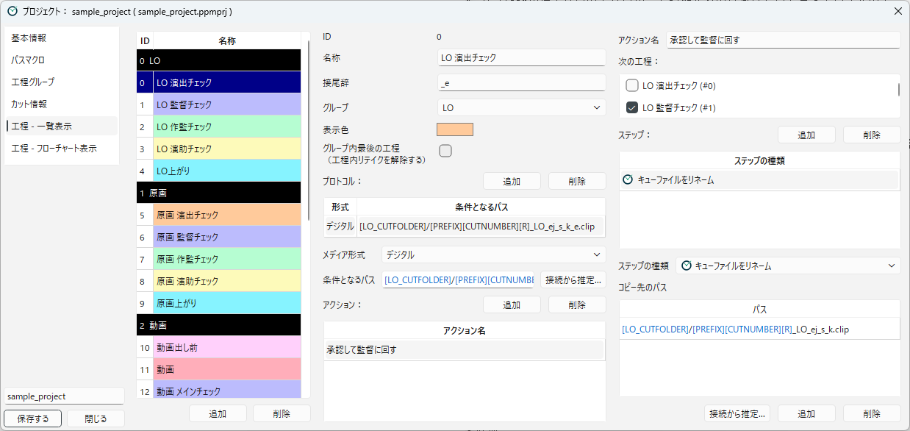
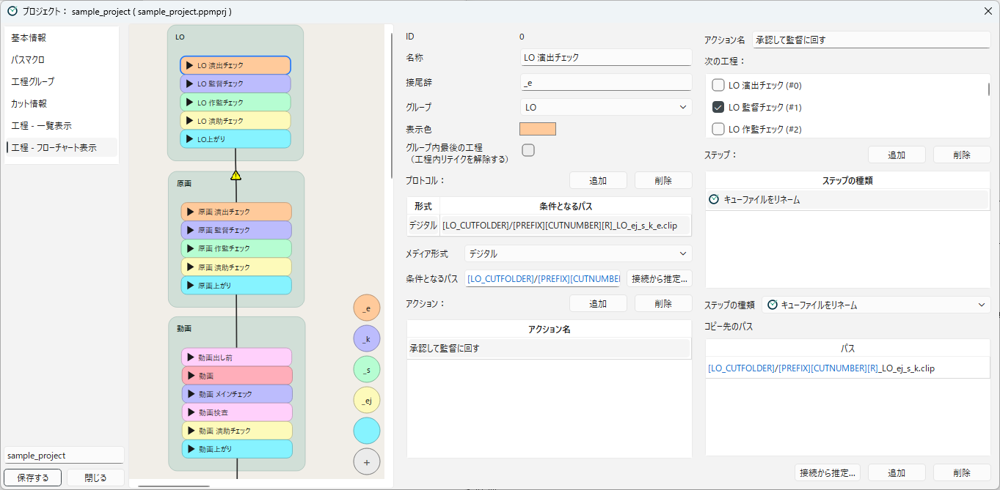

[English](workflows.md)

# 工程を設計する

このページでは、工程と、その中身（プロトコル、アクション、ステップ）を組み立てる方法を説明します。
用語の意味は [用語集](../concepts/glossary.ja.md) を参照してください。

工程の中身は、次のような入れ子になっています。

```
工程（例：LO 演出チェック）
└─ プロトコル（形式と条件パス。カットがこの工程にいるかを判断する）
   └─ アクション（例：承認して監督に回す。メイン画面のボタンになる）
      ├─ 次の工程（例：LO 監督チェック）
      └─ ステップ（例：キューファイルをリネーム）
```

## 一覧表示とフローチャート表示での編集

工程は、2つのカテゴリのどちらでも編集できます。
どちらで編集しても、同じ設定が書き換わります。

| カテゴリ | 向いている作業 |
|---|---|
| **工程 - 一覧表示** | 工程の中身を、1つずつ細かく設定する |
| **工程 - フローチャート表示** | 工程を作る、つなぐ、工程グループに振り分けるなど、全体の流れを組み立てる |

### 一覧表示

**工程 - 一覧表示** では、画面が3つの列に分かれています。



| 列 | 内容 |
|---|---|
| 左 | 工程の一覧です。工程グループごとの見出しの下に、工程が並びます。 |
| 中央 | 選んだ工程の詳細と、プロトコルの一覧です。プロトコルを選ぶと、その下にプロトコルの詳細とアクションの一覧が表示されます。 |
| 右 | 選んだアクションの詳細と、ステップの一覧です。ステップを選ぶと、その下にステップの設定が表示されます。 |

左の一覧では、次の操作ができます。

- **追加**：選んでいる工程グループの最後に、「新規工程」を追加します。
- **削除**：選んでいる工程を削除します。ほかの工程の「次の工程」から、削除した工程への参照も取り除かれます。
- **ドラッグ＆ドロップ**：工程の順番を並べ替えます。別の工程グループの見出しの下に動かすと、工程グループも変わります。

工程の並び順は、メイン画面の一覧表示での並び順になります。

### フローチャート表示

**工程 - フローチャート表示** では、左側に工程のフローチャート、右側に詳細の設定が表示されます。
工程（**工程ノード**）か工程グループの枠をダブルクリックすると、右側にその設定が表示されます。



| 操作 | すること |
|---|---|
| 何もないところを右クリック | 工程グループを選んで、その工程グループに工程ノードを追加します。**新規工程グループ...** を選ぶと、ID名を入れて新しい工程グループを作れます。 |
| 工程グループの枠を右クリック → **ここに工程ノードを追加** | その工程グループに工程ノードを追加します。工程が1つもない枠は、**工程グループ枠を削除** で消せます。 |
| 工程ノードを右クリック → **次工程ノードを追加** | その工程の次の工程を、新しく作ってつなぎます。 |
| 工程ノードを右クリック → **展開する**／**畳む** | 工程ノードの中に、プロトコルとアクションを表示します（ノードの左上のボタンでも切り替えられます）。 |
| 工程ノードの下の端から、別の工程ノードへドラッグ | 工程をつなぎます（次の工程に追加します）。アクションが複数ある場合は、どのアクションからつなぐかを選ぶ画面が表示されます。展開した工程ノードでは、アクションからドラッグすると、そのアクションからつなげます。 |
| つながりの矢印や工程ノードを選んで Delete キー | つながりや工程を削除します。工程ノードの右クリックの **工程の削除** でも削除できます。 |
| 工程ノードを別の工程グループの枠にドラッグ | 工程の工程グループを変えます。 |
| 工程グループの枠の名前の部分をドラッグ | 枠と、その中の工程ノードをまとめて動かします。 |
| マウスホイール、中ボタンでドラッグ | 拡大・縮小、表示の移動をします。 |

工程ノードを、つながっている工程ノードの真下に近づけると、ぴったり揃えて置かれます。

フローチャートでは、設定の漏れが警告のアイコンで表示されます。

- **工程ノードの警告**：条件パスが入っていないプロトコルがあります。
- **つながりの矢印の警告**：前の工程のステップ（キューファイルをリネーム、キューファイルをコピー、キューファイルを作成）が、次の工程の条件パスに当てはまるファイルを作りません。作業者が手でファイルを置く流れなら問題ありませんが、設定を確かめてください。

### 役割ボタン

フローチャートの右下には、**役割ボタン**（丸いアイコン）が並んでいます。
「演出」「監督」のような役割ごとに、工程の名前、表示色、接尾辞をまとめて登録しておき、工程を素早く作るためのものです。

- 役割ボタンを工程グループの枠にドラッグ＆ドロップすると、その工程グループに工程を作ります。工程の名前は「工程グループのラベル名 役割のラベル名」（例：`原画 演出`）になり、役割の表示色と接尾辞が設定されます。
- 工程ノードにドロップすると、その工程の次の工程として作ってつなぎます。
- **+** のボタンで役割を追加します。**ラベル名**、**接尾辞**、**表示色** を入れます。
- 役割ボタンを右クリックすると、**役割を編集...**、**役割を削除** を選べます。

サンプルプロジェクトには、演出（`_e`）、監督（`_k`）、作監（`_s`）、演助（`_ej`）、制作（接尾辞なし）の役割が入っています。
役割は、メイン画面のフローチャート表示の役割ボタンにも使われます（[メイン画面](../using/main-window.ja.md) を参照）。

## 工程をつくる

工程を選ぶと、工程の詳細が表示されます。

| 項目 | 内容 |
|---|---|
| **ID** | 工程の番号です。自動で付き、変えられません。 |
| **名称** | 工程の名前です（例：`LO 演出チェック`）。メイン画面に表示されます。 |
| **接尾辞** | この工程の印として、キューファイルの名前の末尾に付ける文字列です（例：演出チェックなら `_e`）。「条件パスのリネーム連鎖を自動設定」で使われます。 |
| **グループ** | 工程が属する工程グループです。 |
| **表示色** | メイン画面での工程の色です。 |
| **グループ内最後の工程（工程内リテイクを解除する）** | 下の「グループ最後の工程」を参照してください。 |

## プロトコルと条件パス

**プロトコル**は、カットがこの工程にいるかどうかを判断する決まりです。
1つの工程に、プロトコルを複数持たせられます。
たとえば、デジタルの作業ファイル（`.clip`や`.tvpp`）と、紙の作業を表す目印のファイル（`.txt`や、ペンシルテスト用に作成した`.tnz`など）のどちらでも、同じ工程にいるとみなしたいときに使います。

プロトコル一覧の **追加** でプロトコルを増やし、選んだプロトコルの詳細を入れます。

| 項目 | 内容 |
|---|---|
| **メディア形式** | **デジタル**、**紙**、**その他** から選びます。メイン画面の「形式」の列に表示されます。工程内リテイクを使えるのは、デジタルのプロトコルだけです。 |
| **条件となるパス** | 条件パスです。このパスにファイルがあると、カットはこの工程にいるとみなされます。 |

条件パスは、カットフォルダのパスマクロとファイル名で書きます（例：`[LO_CUTFOLDER]/[PREFIX][CUTNUMBER][R]_LO_ej_s_k_e.clip`）。
ファイル名には、工程グループの「テイク表記」に合わせたマクロ（`[R]`、`[TAKE]` など）を入れておきます（[工程グループ](workflow-groups.ja.md) を参照）。

**接続から推定...** ボタンを押すと、前の工程のステップが作るファイルのパスが候補として表示され、選ぶと条件パスに入ります。

条件パスを決めるときは、次のことに気を付けてください。

- 同じ工程グループの中で、ほかの工程の条件パスと同じファイルに当てはまらないようにします。
- カットが一覧に並ぶまでの判定は、[カットがリストに並ぶ条件](../using/scene-list.ja.md) で説明しています。

## アクションとステップの組み立て

**アクション**は、メイン画面の「アクション」の列に表示されるボタンです。
プロトコルを選ぶと、その下にアクションの一覧が表示されます。
**追加** でアクションを増やし、アクションを選ぶと、右の列にアクションの詳細が表示されます。

| 項目 | 内容 |
|---|---|
| **アクション名** | ボタンに表示される名前です（例：`承認して監督に回す`）。 |
| **次の工程** | アクションを実行した後に、カットが進む工程です。チェックボックスで選びます。複数選ぶと、カットは同時に複数の工程に進みます。 |
| **ステップ** | アクションを実行したときに、上から順に行う操作です。 |

アクションが1つだけのプロトコルでは、メイン画面で複数のカットをまとめて実行できます（[カットに対する操作](../using/scene-operations.ja.md) を参照）。

### ステップ

ステップ一覧の **追加** でステップを増やし、ステップを選んで **ステップの種類** と設定を入れます。
ステップは、ドラッグ＆ドロップで並べ替えられます。

使えるステップは、次のとおりです。

| 分類 | ステップ |
|---|---|
| ファイル操作 | キューファイルをリネーム、キューファイルをコピー、フォルダ内容をコピー、ファイルをリネーム、ファイルをコピー、キューファイルを作成、ファイルの消去、空フォルダの作成、フォルダのZIP圧縮 |
| 進捗管理 | 工程グループを移動、傍流工程を開始、傍流工程を終了、カット情報を登録、次工程の追加、進捗の解除 |
| 確認、分岐 | ファイル有無を確認、条件分岐：カット情報、条件分岐：ファイル |
| 外部連携 | Googleスプレッドシートに入力、Google Chatに通知を送る |

それぞれのステップの設定は、[ステップ一覧](../reference/steps.ja.md) で説明します。

パスを入れるステップ（キューファイルをリネームなど）には、**接続から推定...** ボタンがあります。
押すと、次の工程の条件パスが候補として表示され、選ぶとパスに入ります。

## 条件パスのリネーム連鎖を自動設定

チェックの工程が続く流れでは、「次の工程の条件パスにリネームする」ステップと、「接尾辞を付けた条件パス」を、工程ごとに繰り返し設定することになります。
これを自動で行うのが、**条件パスのリネーム連鎖を自動設定** です。

1. **工程 - フローチャート表示** で、工程を作ってつなぎ、それぞれの工程に **接尾辞** を入れておきます（役割ボタンで作ると、接尾辞が自動で入ります）。
2. 流れの最後の工程（例：`原画上がり`）に、条件パスを入れます（例：`[GENGA_CUTFOLDER]/[PREFIX][CUTNUMBER][R]_genga.clip`）。
3. 最後の工程ノードを右クリックし、**条件パスのリネーム連鎖を自動設定** を選びます。

すると、前の工程にさかのぼりながら、次のように設定されます。

| 工程（接尾辞） | 条件パス | アクションのリネーム先 |
|---|---|---|
| 原画 演助チェック（`_ej`） | `..._genga_ej.clip` | `..._genga.clip` |
| 原画 作監チェック（`_s`） | `..._genga_ej_s.clip` | `..._genga_ej.clip` |
| 原画 監督チェック（`_k`） | `..._genga_ej_s_k.clip` | `..._genga_ej_s.clip` |
| 原画 演出チェック（`_e`） | `..._genga_ej_s_k_e.clip` | `..._genga_ej_s_k.clip` |

- すでに条件パスやリネームのステップが入っている場合は、上書きするかどうかを確かめるメッセージが表示されます。
- 接尾辞が空の工程、形式（メディア形式）が違う工程、ほかの工程にも枝分かれしている工程では、そこでさかのぼるのを止めます。
- 終わると、追加・変更したステップと、設定した条件パスの数が表示されます。

## 条件分岐と分岐フロー

アクションの中で条件を調べて、実行するステップを変えたり、次の工程を増やしたりできます。

- **条件分岐：カット情報**、**条件分岐：ファイル**：カット情報の値や、ファイルがあるかどうかで、「真の場合」と「偽の場合」のどちらかのステップを実行します。それぞれに入れられるステップは1つです。
- **次工程の追加**：次の工程に、指定した工程を追加します。条件分岐の中で使うと、条件を満たすときだけ工程を増やせます。追加される工程は、「次の工程」の一覧に「[次工程の追加ステップで追加]」と表示されます。
- **進捗の解除**：指定した工程から、カットを外します。
- **傍流工程を開始**、**傍流工程を終了**：カットの所属はそのままで、別の工程グループの工程にも並べます（[カットが工程を流れる仕組み](../concepts/scene-flow.ja.md) の「傍流」を参照）。

使い方の例は、[条件付きで次工程を追加する](../integrations/add-progress.ja.md) で説明します。

## グループ最後の工程

工程内リテイクで戻したカットは、カット情報「工程内リテイク」が付いたまま工程を進みます（[カットが工程を流れる仕組み](../concepts/scene-flow.ja.md) を参照）。
このカット情報を外す工程を決めるのが、**グループ内最後の工程（工程内リテイクを解除する）** です。

- オンにした工程のアクションを実行すると、カット情報「工程内リテイク」が外れます。
- オフの工程のアクションを実行すると、「工程内リテイク：作業中」が「工程内リテイク：チェック中」に変わります。

通常は、工程グループの最後の工程（`LO上がり` など）か、最後のチェックの工程でオンにします。
サンプルプロジェクトでは、`LO上がり`、`原画上がり`、`動画上がり`、`仕上上がり` でオンになっています。

カット情報が外れるのは、アクションのステップがすべて終わった後です。
そのため、オンにした工程のアクションで作るファイルやリネーム先のパスに `[R]` を書くと、工程内リテイク中は `_r` に置き換えられます。
一方、次の工程グループの条件パスの `[R]` は、カット情報が外れた後に置き換えられるので、空になります。
次の工程グループに渡すファイルのパスには、`[R]` を書かないでください（下の「次の工程グループに渡す」を参照）。
フローチャートでは、オンにした工程から次の工程へのつながりを、次の工程の条件パスから `[R]` を除いて比べます。そのため、渡すファイルのパスに `[R]` を書くと、つながりの矢印に警告のアイコンが表示されます。

## よく使うパターン集

サンプルプロジェクトで使っている組み立て方です。

### チェックを順に回す

キューファイルの名前から、チェックが済んだ人の記号を取っていきます。

| 工程 | 条件パス | ステップ |
|---|---|---|
| LO 演出チェック | `[LO_CUTFOLDER]/[PREFIX][CUTNUMBER][R]_LO_ej_s_k_e.clip` | キューファイルをリネーム：`..._LO_ej_s_k.clip` |
| LO 監督チェック | `[LO_CUTFOLDER]/[PREFIX][CUTNUMBER][R]_LO_ej_s_k.clip` | キューファイルをリネーム：`..._LO_ej_s.clip` |

リネームでできたファイルが次の工程の条件パスに当てはまるので、カットはすぐに次の工程に並びます。

### 次の工程グループに渡す（目印のファイルを置く）

`LO上がり` の「原画に移動」は、次の2つのステップで原画に渡します。

1. **キューファイルを作成**：原画のカットフォルダに、目印のテキストファイル `[GENGA_CUTFOLDER]/[PREFIX][CUTNUMBER]_genga_ej_s_k_e.txt` を作ります。ファイルの中身には、作業者への説明（「原画作業後、CLIPファイルをこの名前にリネームすると演出チェックに送られます。」）を書いておけます。
2. **工程グループを移動**：カットの所属を「原画」に移します。

次の工程（原画 演出チェック）の条件パスは `.clip` なので、作業者が原画を描いて `.clip` として保存するまで、カットはどの工程にも並びません。

### 次の工程グループに渡す（ファイルをコピーする）

`原画上がり` の「動画に移動」は、原画のファイルを動画のカットフォルダにコピーして渡します。

1. **キューファイルをコピー**：`[DOUGA_CUTFOLDER]/[PREFIX][CUTNUMBER]_douga_ej_dk_ch_d_dm.clip` にコピーします。元のファイルは残ります。
2. **工程グループを移動**：カットの所属を「動画」に移します。

コピーしたファイルが次の工程（動画出し前）の条件パスに当てはまるので、カットはすぐに動画の工程に並びます。

### 同時に複数の工程に回す

アクションの **次の工程** で工程を2つ選び、ステップで両方の工程のキューファイルを作ります。
たとえば、キューファイルをリネームのステップにリネーム先を2つ書くと、ファイルがそれぞれのリネーム先に作られ、元のファイルは無くなります。
カットはそれぞれの工程に並び、別々に進みます。

---

[← 目次に戻る](../index.ja.md)
