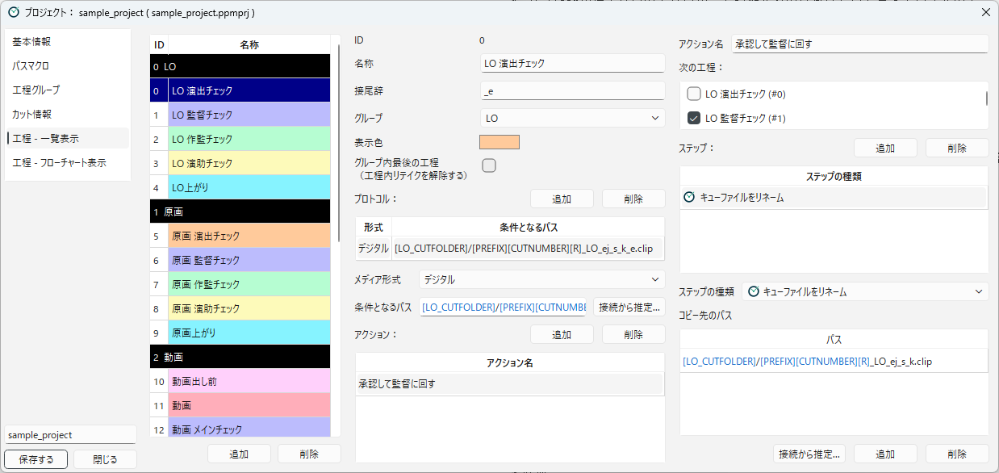
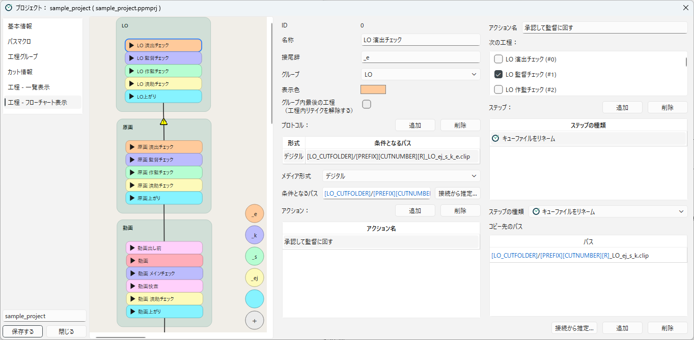

[日本語](workflows.ja.md)

# Designing Workflows

This page explains how to build workflows and their contents (protocols, actions, and steps).
See the [Glossary](../concepts/glossary.md) for the meaning of the terms.

The contents of a workflow are nested as follows.

```
Workflow (e.g. LO 演出チェック, LO episode director check)
└─ Protocol (media and condition path; decides whether a scene is in this workflow)
   └─ Action (e.g. 承認して監督に回す, approve and pass to the director; becomes a button in the main window)
      ├─ Next workflows (e.g. LO 監督チェック, LO director check)
      └─ Steps (e.g. Rename)
```

## Editing in the list and the flowchart

Workflows can be edited in either of two categories.
Both edit the same settings.

| Category | Suited for |
|---|---|
| **Workflows - List** | Setting the contents of workflows one by one in detail |
| **Workflows - Flowchart** | Building the overall flow: creating and linking workflows, and arranging them into workflow groups |

### List

**Workflows - List** is divided into three columns.


<!-- English screenshot to be made: images/en/designing/workflows-list.png -->

| Column | Contents |
|---|---|
| Left | The list of workflows. Workflows are listed under a header for each workflow group. |
| Middle | The details of the selected workflow and its list of protocols. When you select a protocol, its details and list of actions are shown below. |
| Right | The details of the selected action and its list of steps. When you select a step, its settings are shown below. |

In the list on the left, you can do the following:

- **Add**: Adds a "New Workflow" at the end of the selected workflow group.
- **Remove**: Deletes the selected workflow. References to it in the "Next Flows" of other workflows are also removed.
- **Drag and drop**: Reorders workflows. Moving a workflow under the header of another workflow group also changes its workflow group.

The order of workflows is the order in the list view of the main window.

### Flowchart

**Workflows - Flowchart** shows the flowchart of workflows on the left and the detailed settings on the right.
Double-click a workflow (**workflow node**) or the frame of a workflow group to show its settings on the right.


<!-- English screenshot to be made: images/en/designing/workflows-flowchart.png -->

| Operation | What it does |
|---|---|
| Right-click an empty area | Choose a workflow group and add a workflow node to it. Choose **New Group...** to enter an ID name and create a new workflow group. |
| Right-click a workflow group frame → **Add Workflow Node Here** | Adds a workflow node to that workflow group. A frame with no workflows can be removed with **Delete Group Frame**. |
| Right-click a workflow node → **Add Next Workflow Node** | Creates a new next workflow of that workflow and links it. |
| Right-click a workflow node → **Expand** / **Collapse** | Shows the protocols and actions inside the workflow node (you can also toggle it with the button at the top left of the node). |
| Drag from the bottom edge of a workflow node to another workflow node | Links the workflows (adds a next workflow). If there are several actions, a dialog for choosing which action to link from is shown. In an expanded workflow node, drag from an action to link from that action. |
| Select a link arrow or workflow node and press the Delete key | Deletes the link or workflow. You can also delete a workflow with **Delete Workflow** in the right-click menu of the node. |
| Drag a workflow node into the frame of another workflow group | Changes the workflow group of the workflow. |
| Drag the name part of a workflow group frame | Moves the frame together with the workflow nodes in it. |
| Mouse wheel, middle-button drag | Zooms in and out, and moves the view. |

When you bring a workflow node close to just below a workflow node it is linked to, it snaps into alignment.

The flowchart shows missing settings with warning icons.

- **Warning on a workflow node**: A protocol has no condition path.
- **Warning on a link arrow**: The steps of the previous workflow (Rename, Copy, Create Cue File) do not create a file that matches the condition path of the next workflow. This is fine if a worker puts the file by hand, but check the settings.

### Role buttons

At the bottom right of the flowchart are the **role buttons** (round icons).
They register the workflow name, color, and suffix for each role, such as "演出" (episode director) or "監督" (director), so that workflows can be created quickly.

- Drag and drop a role button onto a workflow group frame to create a workflow in that workflow group. The workflow is named "label name of the workflow group + label name of the role" (e.g. `原画 演出`), and the color and suffix of the role are set.
- Drop it onto a workflow node to create a workflow as the next workflow of that workflow and link it.
- Press the **+** button to add a role. Enter the **Label Name**, **Suffix**, and **Color**.
- Right-click a role button to choose **Edit Role...** or **Delete Role**.

The sample project includes the roles 演出 (episode director, `_e`), 監督 (director, `_k`), 作監 (animation director, `_s`), 演助 (assistant director, `_ej`), and 制作 (production, no suffix).
The roles are also used for the role buttons in the flowchart view of the main window (see [Main Window](../using/main-window.md)).

## Creating a workflow

When you select a workflow, its details are shown.

| Item | Contents |
|---|---|
| **ID** | The number of the workflow. Assigned automatically and cannot be changed. |
| **Name** | The name of the workflow (e.g. `LO 演出チェック`). Shown in the main window. |
| **Suffix** | The string added to the end of the cue file name as the mark of this workflow (e.g. `_e` for the episode director check). Used by "Auto-configure renaming chains for condition paths". |
| **Group** | The workflow group the workflow belongs to. |
| **Color** | The color of the workflow in the main window. |
| **The Last Workflow In Group (Clears Rewind On Complete)** | See "The last workflow in a group" below. |

## Protocols and condition paths

A **protocol** is the rule that decides whether a scene is in this workflow.
A workflow can have several protocols.
For example, use them when you want a scene to be regarded as being in the same workflow whether it has a digital work file (such as `.clip` or `.tvpp`) or a marker file for paper work (such as `.txt`, or a `.tnz` created for a pencil test).

Add protocols with **Add** in the protocol list, and enter the details of the selected protocol.

| Item | Contents |
|---|---|
| **Media Type** | Choose **Digital**, **Paper**, or **Other**. Shown in the "Media" column of the main window. Rewinds can be used only with digital protocols. |
| **Condition Path** | The condition path. If a file exists at this path, the scene is regarded as being in this workflow. |

Write the condition path with the path macro of the scene folder and a file name (e.g. `[LO_CUTFOLDER]/[PREFIX][CUTNUMBER][R]_LO_ej_s_k_e.clip`).
Put the macro that matches the "Take Notation" of the workflow group (`[R]`, `[TAKE]`, and so on) in the file name (see [Workflow Groups](workflow-groups.md)).

Press the **Suggest...** button to show the paths of the files created by the steps of the previous workflows as candidates; choose one to enter it as the condition path.

Keep the following in mind when deciding condition paths:

- Within the same workflow group, a condition path must not match the same file as the condition path of another workflow.
- How it is decided whether a scene is listed is explained in [Which Scenes Appear in the List](../using/scene-list.md).

## Building actions and steps

An **action** is a button shown in the "Action" column of the main window.
When you select a protocol, its list of actions is shown below.
Add actions with **Add**, and select an action to show its details in the right column.

| Item | Contents |
|---|---|
| **Action Name** | The name shown on the button (e.g. `承認して監督に回す`, approve and pass to the director). |
| **Next Flows** | The workflows the scene moves to after the action runs. Choose them with checkboxes. If you choose several, the scene moves to several workflows at the same time. |
| **Steps** | The operations performed from the top when the action runs. |

For protocols with only one action, several scenes can be run together in the main window (see [Working on a Scene](../using/scene-operations.md)).

### Steps

Add steps with **Add** in the step list, select a step, and enter its **Step Type** and settings.
Steps can be reordered by drag and drop.

The available steps are as follows.

| Category | Steps |
|---|---|
| File operations | Rename, Copy, Copy Folder Contents, Rename File, Copy File, Create Cue File, Ask Delete, Create Empty Folder, Zip Folder |
| Progress management | Move Flow Group, Start Branch Flow, End Branch Flow, Set Scene Info Tag, Add Next Workflow, Release Progress |
| Checks and branches | Check Existence, Conditional Branch By Info Tag, Conditional Branch By File Existence |
| Integrations | Input Google Spreadsheet, Notify Google Chat |

The settings of each step are explained in [Steps](../reference/steps.md).

Steps that take paths (such as Rename) have a **Suggest...** button.
Press it to show the condition paths of the next workflows as candidates; choose one to enter it as the path.

## Auto-configure renaming chains for condition paths

In a flow where check workflows follow one another, you set "a step that renames to the condition path of the next workflow" and "a condition path with the suffix added" for each workflow over and over.
**Auto-configure renaming chains for condition paths** does this automatically.

1. In **Workflows - Flowchart**, create and link the workflows, and enter a **Suffix** for each of them (workflows created with role buttons get the suffix automatically).
2. Enter the condition path of the last workflow of the flow (e.g. `原画上がり`, key animation up: `[GENGA_CUTFOLDER]/[PREFIX][CUTNUMBER][R]_genga.clip`).
3. Right-click the last workflow node and choose **Auto-configure renaming chains for condition paths**.

PPM then goes back through the previous workflows and sets them as follows.

| Workflow (suffix) | Condition path | Rename destination of the action |
|---|---|---|
| 原画 演助チェック, assistant director check (`_ej`) | `..._genga_ej.clip` | `..._genga.clip` |
| 原画 作監チェック, animation director check (`_s`) | `..._genga_ej_s.clip` | `..._genga_ej.clip` |
| 原画 監督チェック, director check (`_k`) | `..._genga_ej_s_k.clip` | `..._genga_ej_s.clip` |
| 原画 演出チェック, episode director check (`_e`) | `..._genga_ej_s_k_e.clip` | `..._genga_ej_s_k.clip` |

- If a condition path or rename step is already set, a message asks whether to overwrite it.
- Going back stops at a workflow with an empty suffix, a workflow with a different media type, and a workflow that also branches to other workflows.
- When it is done, the numbers of added and changed steps and of the condition paths set are shown.

## Conditional branches and branch flows

An action can check conditions to change the steps it runs or to add next workflows.

- **Conditional Branch By Info Tag**, **Conditional Branch By File Existence**: Run the "If True" or "If False" step, depending on the value of a scene info tag or whether a file exists. Each can hold one step.
- **Add Next Workflow**: Adds the specified workflow to the next workflows. Used in a conditional branch, it adds the workflow only when the condition is met. Workflows added this way are marked "[added by Add Next Workflow]" in the "Next Flows" list.
- **Release Progress**: Removes the scene from the specified workflow.
- **Start Branch Flow**, **End Branch Flow**: Lists the scene in the workflows of another workflow group as well, while it keeps its membership (see "Branch flows" in [How Scenes Flow Through Workflows](../concepts/scene-flow.md)).

Examples are explained in [Adding Next Workflows Conditionally](../integrations/add-progress.md).

## The last workflow in a group

A scene sent back by a rewind keeps the "Rewind" scene info tag while it moves through the workflows (see [How Scenes Flow Through Workflows](../concepts/scene-flow.md)).
**The Last Workflow In Group (Clears Rewind On Complete)** decides the workflow that removes this tag.

- When an action of a workflow with this on runs, the "Rewind" scene info tag is removed.
- When an action of a workflow with this off runs, "Rewind: WIP" changes to "Rewind: Checking".

Usually, turn it on for the last workflow of the workflow group (such as `LO上がり`, LO up) or the last check workflow.
In the sample project, it is on for `LO上がり`, `原画上がり`, `動画上がり`, and `仕上上がり`.

The tag is removed after all the steps of the action have run.
So if you write `[R]` in the path of a file that an action of this workflow creates or renames to, it is replaced with `_r` during a rewind.
On the other hand, `[R]` in the condition paths of the next workflow group is replaced after the tag is removed, so it becomes empty.
Do not write `[R]` in the paths of files passed to the next workflow group (see "Passing to the next workflow group" below).
The flowchart compares the link from a workflow with this on to the next workflow without `[R]` in the next workflow's condition path. So if you write `[R]` in the path of the passed file, the link arrow shows a warning icon.

## Common patterns

These are the patterns used in the sample project.

### Passing through checks in order

Remove the mark of the person who has finished checking from the cue file name.

| Workflow | Condition path | Step |
|---|---|---|
| LO 演出チェック (episode director check) | `[LO_CUTFOLDER]/[PREFIX][CUTNUMBER][R]_LO_ej_s_k_e.clip` | Rename: `..._LO_ej_s_k.clip` |
| LO 監督チェック (director check) | `[LO_CUTFOLDER]/[PREFIX][CUTNUMBER][R]_LO_ej_s_k.clip` | Rename: `..._LO_ej_s.clip` |

The renamed file matches the condition path of the next workflow, so the scene is listed in the next workflow right away.

### Passing to the next workflow group (putting a marker file)

"原画に移動" (move to key animation) of `LO上がり` (LO up) passes the scene to key animation with the following two steps.

1. **Create Cue File**: Creates the marker text file `[GENGA_CUTFOLDER]/[PREFIX][CUTNUMBER]_genga_ej_s_k_e.txt` in the key animation scene folder. You can write instructions for the worker in the file (e.g. "After the key animation work, rename the CLIP file to this name to send it to the episode director check").
2. **Move Flow Group**: Moves the membership of the scene to "genga" (key animation).

The condition path of the next workflow (key animation episode director check) is a `.clip` file, so the scene is not listed in any workflow until the worker draws the key animation and saves it as a `.clip` file.

### Passing to the next workflow group (copying the file)

"動画に移動" (move to in-between) of `原画上がり` (key animation up) passes the scene by copying the key animation file to the in-between scene folder.

1. **Copy**: Copies the file to `[DOUGA_CUTFOLDER]/[PREFIX][CUTNUMBER]_douga_ej_dk_ch_d_dm.clip`. The original file remains.
2. **Move Flow Group**: Moves the membership of the scene to "douga" (in-between).

The copied file matches the condition path of the next workflow (動画出し前, before in-between), so the scene is listed in the in-between workflow right away.

### Sending to several workflows at once

Choose two workflows in **Next Flows** of the action, and create the cue files of both workflows with steps.
For example, if you write two rename destinations in a Rename step, the file is created at each destination, and the original file is removed.
The scene is listed in each workflow and moves on separately.

---

[← Back to contents](../index.md)
