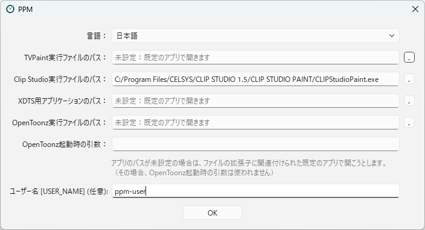

[日本語](initial-setup.ja.md)

# Initial Setup

When you start PPM for the first time, set the language and the applications for your work in **Preferences**.
Preferences are saved for each Windows user, so each staff member only needs to do this once on their own PC.

To open Preferences, press the gear button (**Project Settings / Preferences**) at the top right of the main window and choose **Preferences** from the menu.

<!-- English screenshot to be made: images/en/getting-started/preferences.png -->

> If PPM starts in Japanese, the gear button menu has three items: プロジェクト設定 (Project Settings), 環境設定 (Preferences), and PPM について (About PPM).
> Choose the second one, 環境設定, and select "English" in 言語 (Language).

> For administrators: by placing `defaultusersettings.ini` in the Stuff folder, you can set the initial values of the preferences for everyone.
> See [The Stuff Folder](../administration/stuff-folder.md) for details.

## Choosing the language

In **Language**, choose the language of the PPM user interface.
At first, the display language of Windows is used (English if there is no translation file for that language).
The change takes effect the next time PPM is started.

The available languages are those of the translation files in the `loc` folder of the Stuff folder.
Choose "English" to show the user interface in English without a translation.

## Setting the application paths

In the PPM list, you can open the file of each scene directly with the **Open** button.
Set the executable file (`.exe`) of the application used for each file type.
Press the "..." button to the right of a field to choose the file.

| Setting | Files to open |
|---|---|
| TVPaint executable path | TVPaint projects (`.tvpp`) |
| Clip Studio executable path | CLIP STUDIO PAINT files (`.clip`) |
| OpenToonz executable path | OpenToonz scene files (`.tnz`) |
| XDTS application path (such as XDTS Viewer or Toei Animation Digital Exposure Sheet) | Timesheet files (`.xdts`) |

If a path is **left empty**, the file is opened with the application associated with its file extension in Windows.
For example, if you already open `.clip` files with CLIP STUDIO PAINT, you can leave the Clip Studio path empty.

In **OpenToonz arguments**, you can write startup options added when OpenToonz opens a `.tnz` file.
They are not used if the OpenToonz path is empty.

If no file is found at a path you set, a warning is shown when PPM starts.
If the installation folder of an application changes (for example, after an upgrade), set the path again.

## User name

**User Name [USER_NAME]** is the name substituted for `[USER_NAME]` in the project settings.
It matters, for example, when `[USER_NAME]` is used in the path of a personal work folder, or when you want to record the name of the person in charge on the scene sheet.

If you leave it empty, the name of the user signed in to Windows (shown faintly in the field) is used.
Enter a name only if you want to use a name different from your Windows user name.
Follow the instructions of your pipeline designer on what name to enter.

> The user name recorded in the operation log of a scene is always the Windows user name, regardless of this setting.

---

[← Back to contents](../index.md)
