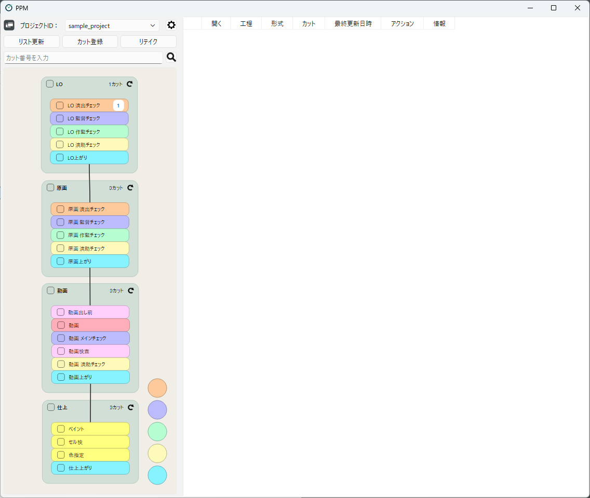
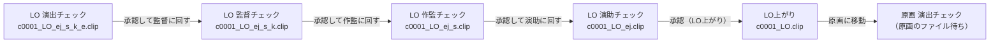
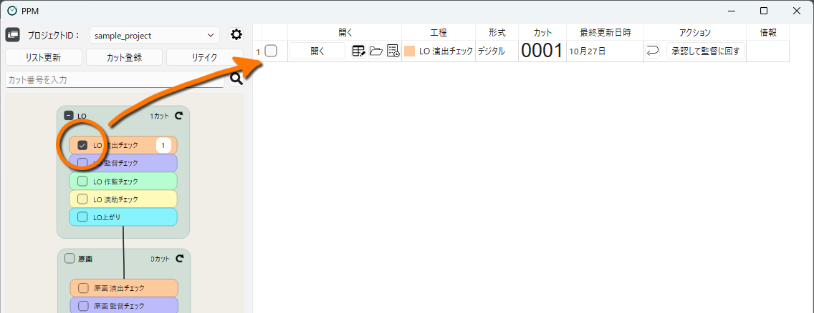
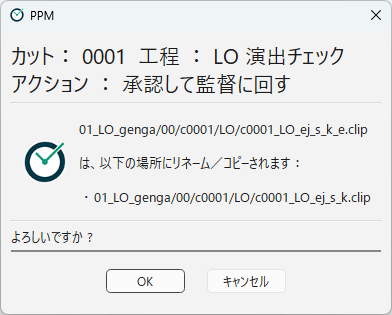
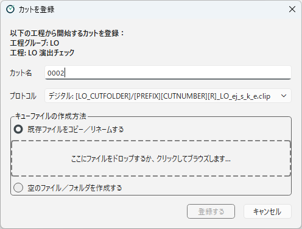

[English](tutorial.md)

# チュートリアル：カットを1つ最後まで進める

配布物に含まれるサンプルプロジェクトを使って、1つのカットをレイアウト（LO）の工程から原画の工程まで進めてみます。
PPM の基本的な操作と、「ファイルの名前と場所が進捗になる」という考え方がつかめます。

> このチュートリアルを行うと、Stuff フォルダの `sample_data` の中のファイルが書き換わります。
> 最初からやり直したいときは、配布物の ZIP から `stuff/sample_data` を展開し直してください。

## サンプルプロジェクトを開く

1. `ppm.exe` を起動します。
2. 画面左上の **プロジェクトID** で `sample_project` を選びます。
3. **一覧表示／フローチャート表示の切り替え** ボタンを押して、フローチャート表示にします。

画面の左側に、工程のつながりが表示されます。
サンプルプロジェクトには、「LO」「原画」「動画」「仕上」の4つの**工程グループ**があり、それぞれの中に**工程**が並んでいます。

サンプルの LO の工程は、次のように流れます。
ファイル名の末尾（サフィックス）が、そのファイルを次にチェックする人を表しています。

このサンプルでは、末尾の `_e`（演出）を外すと監督へ、`_k`（監督）を外すと作監へ……というように、チェックが済むごとにサフィックスを1つずつ外していく運用方法を採用しています。（実際の運用では自由なルールを組み立てられます。）
PPM は、この決まりどおりのリネームを、ボタンひとつで行います。

## カットを確認する

フローチャートの **LO 演出チェック** のチェックボックスをオンにします。
画面右側の一覧に、カット `c0001` が表示されます。

`c0001` が LO 演出チェックの工程に並んでいるのは、次の2つの条件を満たしているからです。

- カット `c0001` が、工程グループ「LO」に所属している
- LO のカットフォルダに、`c0001_LO_ej_s_k_e.clip` という名前のファイルがある

この「工程にあることを示すファイル」を、PPM では**キューファイル**と呼びます。
詳しくは [カットがリストに並ぶ条件](../using/scene-list.ja.md) で説明します。

一覧の行にあるボタンで、次の操作ができます。

| ボタン | できること |
|---|---|
| 開く | カットのファイル（ここでは `c0001_LO_ej_s_k_e.clip`）を、作業用のアプリで開きます |
| タイムシートを開く（アイコン） | カットのタイムシート（XDTS）を開きます |
| カットフォルダを開く（アイコン） | カットのファイルがあるフォルダを、エクスプローラーで開きます |
| ログを見る（アイコン） | カットの操作ログを表示します |

アイコンのボタンは、マウスポインターを重ねると名前が表示されます。

**開く** を押して、ファイルが開くことを確かめてみてください。
（CLIP STUDIO PAINT がない PC では、ファイルは開きません。そのまま次に進んで構いません）

## 工程を完了する

演出チェックが済んだとして、カットを監督チェックに回します。

1. `c0001` の行の **アクション** の列にある **承認して監督に回す** ボタンを押します。
2. 確認画面が表示され、これから行う操作が表示されます。
   ここでは、`c0001_LO_ej_s_k_e.clip` を `c0001_LO_ej_s_k.clip` にリネームする、という内容です。
3. 内容を確認して **OK** を押します。

「アクションが完了しました。」と表示されたら、**OK** を押します。
`c0001` の行が灰色になり、アクションのボタンの代わりに **取り消す** ボタンが表示されます。

**リスト更新** ボタンを押すと、`c0001` が LO 演出チェックの一覧から消えます。
フローチャートの **LO 監督チェック** のチェックボックスをオンにすると、`c0001` がそちらに移っていることがわかります。

エクスプローラーで LO のカットフォルダ（`stuff/sample_data/01_LO_genga/00/c0001/LO`）を開くと、
ファイル名が実際に `c0001_LO_ej_s_k.clip` に変わっていることも確かめられます。
PPM の進捗は、このファイル名そのものです。

> アクションは、確認画面で **キャンセル** を押せば実行されません。
> 間違えて実行してしまった場合は、リスト更新を押す前に、灰色になった行の **取り消す** ボタンを押すと元に戻せます。
> 詳しくは [カットに対する操作](../using/scene-operations.ja.md) を参照してください。

## 次の工程グループに進む

同じ要領で、監督チェック → 作監チェック → 演助チェック → LO上がり と進めます。
各工程のアクションのボタン（**承認して作監に回す**、**承認して演助に回す**、**承認（LO上がり）**）を順に押してください。

**LO上がり** の工程まで来たら、**原画に移動** を押します。
このアクションは、リネームではなく次の2つを行います。

- 原画のカットフォルダに、原画の作業者への案内を書いたテキストファイル（`c0001_genga_ej_s_k_e.txt`）を作る
- カット `c0001` の所属を、工程グループ「LO」から「原画」に移す

`c0001` は LO の工程からはなくなりましたが、まだ原画の工程にも並びません。
原画の工程に並ぶには、原画のファイル（`c0001_genga_ej_s_k_e.clip`）が必要だからです。

原画の作業者になったつもりで、原画のファイルを用意します。

1. エクスプローラーで原画のカットフォルダ（`stuff/sample_data/01_LO_genga/00/c0001/genga`）を開きます。
2. LO のカットフォルダにある `c0001_LO.clip` をコピーして、原画のカットフォルダに貼り付けます。
3. 貼り付けたファイルの名前を、テキストファイルと同じ `c0001_genga_ej_s_k_e`（拡張子は `.clip`）に変えます。
4. PPM に戻り、**リスト更新** ボタンを押します。

フローチャートの **原画 演出チェック** をオンにすると、`c0001` が並んでいます。
実際の運用では、原画マンが作業を終えたファイルをこの名前で保存することで、カットが演出チェックに回ります。

## 新しいカットを登録する

最後に、新しいカット `c0002` を LO の最初の工程に登録します。

1. フローチャートの **LO 演出チェック** を右クリックし、**この工程から始めるカットを登録する** を選びます。
2. **カット名** に `0002` と入力します（カット番号の前に付く `c` は、プロジェクトの設定で自動的に付きます）。
3. **キューファイルの作成方法** で **既存ファイルをコピー／リネームする** を選び、
   ファイルの欄に、元にするファイル（たとえば `c0001` の LO のファイル）をドロップします。
4. **登録する** を押し、確認画面（**登録の確認**）で内容を確かめて登録します。

元にしたファイルが `c0002_LO_ej_s_k_e.clip` という名前で LO のカットフォルダにコピーされ、
`c0002` が LO 演出チェックの一覧に並びます。

## 次に読むページ

おつかれさまでした。チュートリアルでは、次のことを体験しました。

- 工程を選んで、その工程にあるカットを一覧にする
- アクションのボタンで、決められたファイル操作を行い、カットを次の工程に進める
- 工程グループをまたいでカットを移す
- 新しいカットを登録する

PPM がこれらをどんな仕組みで行っているかは、[2. PPMの仕組み](../concepts/glossary.ja.md) で説明します。
日々の操作をもっと詳しく知りたい場合は、[メイン画面](../using/main-window.ja.md) から読み進めてください。
リテイクの出し方は [リテイク](../using/retakes.ja.md) で説明します。

---

[← 目次に戻る](../index.ja.md)
