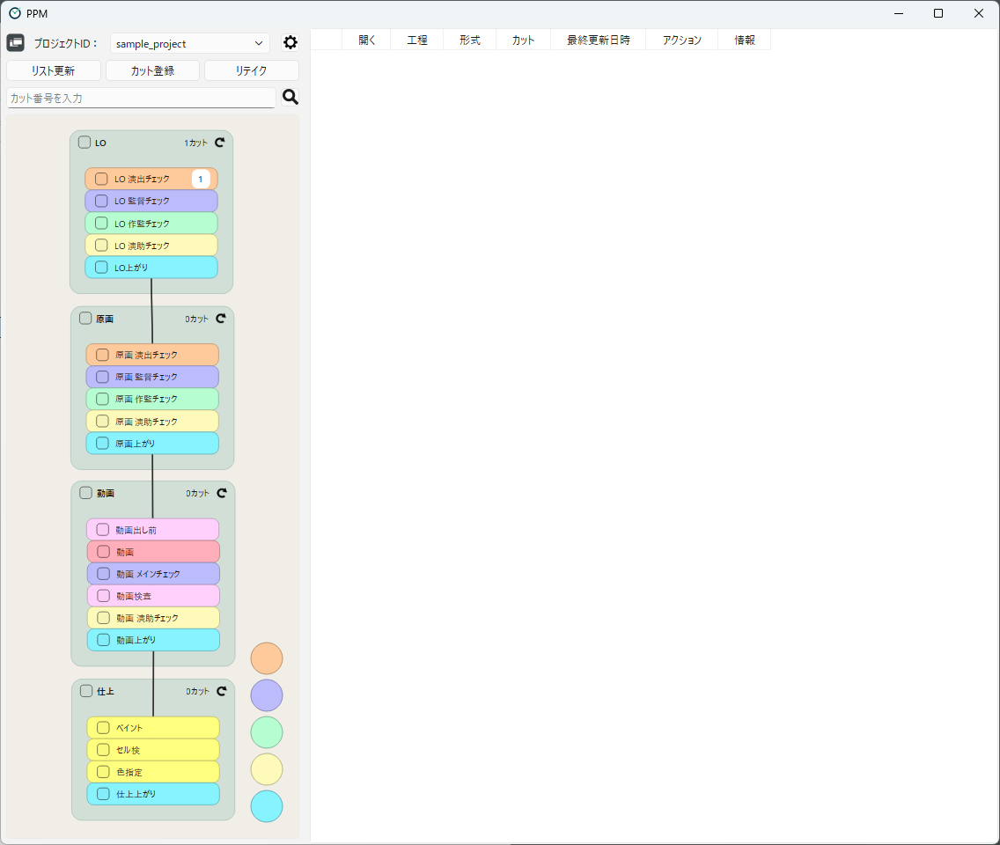
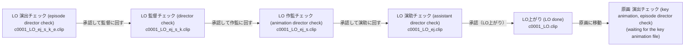
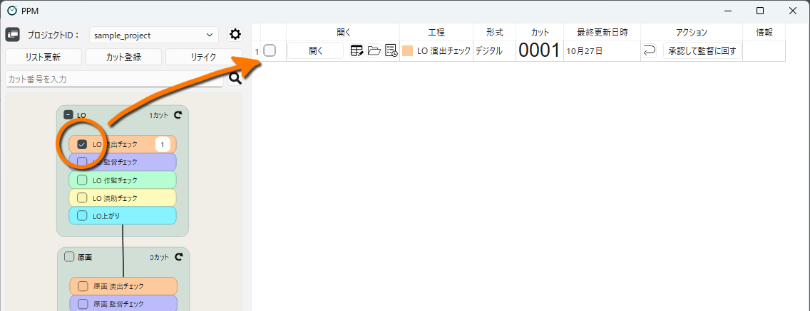
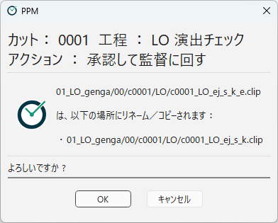
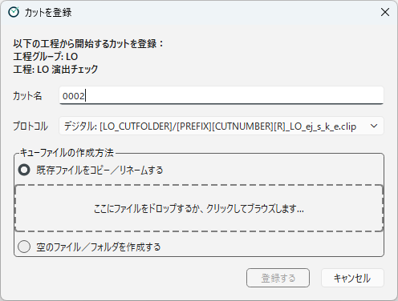

[日本語](tutorial.ja.md)

# Tutorial: Moving a Scene Through the Pipeline

Using the sample project included in the distribution, you will move a scene from the layout (LO) workflows to the key animation workflows.
You will learn the basic operations of PPM and the idea that "the names and locations of the files are the progress".

> This tutorial modifies the files in the `sample_data` folder of the Stuff folder.
> To start over, extract `stuff/sample_data` from the distributed ZIP file again.

> The names of the workflows and actions in the sample project are in Japanese.
> This page shows their English meaning in parentheses.

## Opening the sample project

1. Start `ppm.exe`.
2. In **Project** at the top left of the window, select `sample_project`.
3. Press the **Switch between list view and flowchart view** button to switch to the flowchart view.

The connections between the workflows are shown on the left side of the window.
The sample project has four **workflow groups**: LO (layout), 原画 (key animation), 動画 (in-between), and 仕上 (ink and paint). Each group contains several **workflows**.

<!-- English screenshot to be made: images/en/getting-started/tutorial-open-project.png -->

The LO workflows of the sample flow as follows.
The suffixes at the end of the file name show who checks the file next.

This sample uses a rule where removing `_e` (episode director) from the end passes the file to the director, removing `_k` (director) passes it to the animation director, and so on.
One suffix is removed each time a check is done. (In actual production, you can build any rules you like.)
PPM performs this renaming with a single button.

## Checking the scene

Turn on the checkbox of **LO 演出チェック** (LO episode director check) in the flowchart.
The scene `c0001` appears in the list on the right side of the window.

`c0001` is listed in this workflow because it meets the following two conditions:

- The scene `c0001` belongs to the workflow group "LO".
- The LO scene folder contains a file named `c0001_LO_ej_s_k_e.clip`.

In PPM, this file that shows a scene is in a workflow is called a **cue file**.
See [Which Scenes Appear in the List](../using/scene-list.md) for details.

<!-- English screenshot to be made: images/en/getting-started/tutorial-scene-list.png -->

The buttons in each row of the list let you do the following.

| Button | What it does |
|---|---|
| Open | Opens the file of the scene (here, `c0001_LO_ej_s_k_e.clip`) with the application for your work |
| Open XDTS (icon) | Opens the timesheet (XDTS) of the scene |
| Open Containing Folder (icon) | Opens the folder containing the scene files in Explorer |
| View Log (icon) | Shows the operation log of the scene |

The name of an icon button is shown when you hover the mouse pointer over it.

Press **Open** to check that the file opens.
(On a PC without CLIP STUDIO PAINT, the file does not open. You can go on to the next step anyway.)

## Completing a workflow

Assuming the episode director's check is done, pass the scene to the director's check.

1. In the **Action** column of the `c0001` row, press the **承認して監督に回す** (approve and pass to the director) button.
2. A confirmation dialog shows the operations that will be performed.
   Here, `c0001_LO_ej_s_k_e.clip` will be renamed to `c0001_LO_ej_s_k.clip`.
3. Check the contents and press **OK**.

<!-- English screenshot to be made: images/en/getting-started/tutorial-action-confirmation.png -->

When "Action Completed." is shown, press **OK**.
The row of `c0001` turns gray, and an **Undo** button is shown in place of the action buttons.

Press the **Refresh** button, and `c0001` disappears from the list of the episode director check.
Turn on the checkbox of **LO 監督チェック** (LO director check) in the flowchart, and you will see that `c0001` has moved there.

If you open the LO scene folder (`stuff/sample_data/01_LO_genga/00/c0001/LO`) in Explorer,
you can also see that the file has actually been renamed to `c0001_LO_ej_s_k.clip`.
In PPM, this file name itself is the progress.

> An action is not performed if you press **Cancel** in the confirmation dialog.
> If you performed an action by mistake, press the **Undo** button in the gray row before pressing Refresh to undo it.
> See [Working on a Scene](../using/scene-operations.md) for details.

## Moving on to the next workflow group

In the same way, move the scene through the director check → animation director check → assistant director check → LO done.
Press the action buttons of each workflow in order: **承認して作監に回す** (pass to the animation director), **承認して演助に回す** (pass to the assistant director), and **承認（LO上がり）** (approve, LO done).

When the scene reaches **LO上がり** (LO done), press **原画に移動** (move to key animation).
Instead of renaming, this action does the following two things:

- It creates a text file (`c0001_genga_ej_s_k_e.txt`) with instructions for the key animator in the key animation scene folder.
- It moves the scene `c0001` from the workflow group "LO" to "原画" (key animation).

`c0001` is no longer in the LO workflows, but it does not appear in the key animation workflows yet,
because the key animation file (`c0001_genga_ej_s_k_e.clip`) is required for that.

Prepare the key animation file as if you were the key animator.

1. In Explorer, open the key animation scene folder (`stuff/sample_data/01_LO_genga/00/c0001/genga`).
2. Copy `c0001_LO.clip` from the LO scene folder and paste it into the key animation scene folder.
3. Rename the pasted file to `c0001_genga_ej_s_k_e` (with the `.clip` extension), the same name as the text file.
4. Go back to PPM and press the **Refresh** button.

Turn on **原画 演出チェック** (key animation, episode director check) in the flowchart, and `c0001` is listed there.
In actual production, the scene is passed to the episode director's check when the key animator saves the finished file with this name.

## Registering a new scene

Finally, register a new scene `c0002` in the first LO workflow.

1. Right-click **LO 演出チェック** in the flowchart and choose **Register a scene starting from this workflow**.
2. Enter `0002` in **Scene Name**. (The `c` before the scene number is added automatically by the project settings.)
3. In **Cue File Creation Method**, choose **Copy/rename an existing file**,
   and drop the file to copy from (for example, the LO file of `c0001`) onto the file field.
4. Press **Register**, check the contents in the confirmation dialog (**Confirm Registration**), and register the scene.

The file is copied to the LO scene folder with the name `c0002_LO_ej_s_k_e.clip`,
and `c0002` is listed in the LO episode director check.

<!-- English screenshot to be made: images/en/getting-started/tutorial-register-scene.png -->

## Next steps

Well done. In this tutorial, you have:

- Selected a workflow to list the scenes in it
- Used action buttons to perform predefined file operations and move a scene to the next workflow
- Moved a scene between workflow groups
- Registered a new scene

[2. How PPM Works](../concepts/glossary.md) explains the mechanisms behind these operations.
To learn more about the daily operations, continue with [Main Window](../using/main-window.md).
How to issue a retake is explained in [Retakes](../using/retakes.md).

---

[← Back to contents](../index.md)
