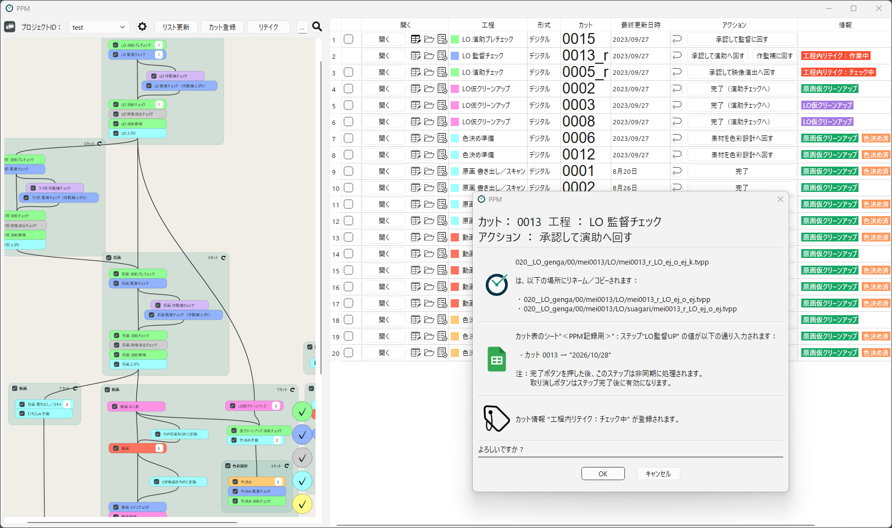

[English](index.md)

# PPM マニュアル

PPM は、アニメーション制作の進捗を管理するための Windows 用ソフトウェアです。
共有フォルダにあるカットのファイルを見て「どのカットが、いまどの工程にあるか」を一覧にし、
工程を進めるときのファイル操作（リネーム・コピー・カット表の記録など）をボタンひとつで行います。

## PPMとは

### 目的

アニメーションのデジタル制作の現場では、作業の受け渡しを「ファイル名の付け替え」や「フォルダ間の移動」で行うことが多くあります。
たとえば、ファイルやフォルダ名の末尾に `_e`（演出）や `_k`（監督）を付けて、チェック完了の印にしたり、次にチェックする人を示す、といった運用です。

この方法は手軽な反面、次のような問題が起きがちです。

- リネームやコピーの手順を間違える（付け忘れ、二重に付ける、別のフォルダに置く）
- 自分の担当のカットがどれなのか、フォルダを見て回らないとわからない
- いつ、誰が、どの工程を進めたのか、あとから追えない

PPM は、こうした「ファイルによる受け渡し」のルールをプロジェクトごとに定義しておき、
その手順をソフトに任せることで、ミスを減らし、進捗を見えるようにします。

### 特長

- **ファイルがそのまま進捗になる**：専用のサーバーやデータベースは不要です。
  ファイルの名前と場所から、各カットがどの工程にあるかを判断します。
  PPM を使わずにエクスプローラーでファイルを見ても、進捗がわかります。
- **工程を進める操作をボタンひとつで**：「承認して監督に回す」のようなボタンを押すと、
  あらかじめ決めた手順（リネーム、コピー、カット表の記入、次の工程の目印となるファイルの作成など）を、確認画面を挟んでまとめて実行します。
- **自分の担当のカットだけを並べられる**：工程や工程グループを選ぶと、その工程にあるカットが一覧になります。
  ファイルを開く、カットフォルダを開く、タイムシート（XDTS）を開く、といった操作も一覧から行えます。
- **流れが見える**：工程のつながりをフローチャートで表示し、各工程にいくつカットがあるかがひと目でわかります。
- **履歴が残る**：カットごとに、いつ、誰が、どの操作をしたかがログに記録されます。
- **リテイクに対応**：リテイクを出したカットを、テイク番号つきで工程に戻せます。
- **パイプラインは自分たちで設計できる**：工程やファイルの命名規則、ボタンを押したときの手順は、
  プロジェクト設定の画面で作品ごとに組み立てられます。プログラムを書く必要はありません。
- **外部サービスとの連携**：Google スプレッドシートへの進捗の書き込みや、Google Chat への通知も行えます。

## このマニュアルの読み方

PPM に関わる人は、主に次の3つの立場に分かれます。自分の立場に合わせて、次の順で読むことをおすすめします。

| 立場 | どんな人か | おすすめの読み方 |
|---|---|---|
| スタッフ | 演出・監督・作監・演助・作画スタッフ・仕上スタッフ・制作進行など、日々 PPM でカットを進める人 | [1. はじめよう](getting-started/installation.ja.md) → [2. PPMの仕組み](concepts/glossary.ja.md) → [3. ソフトを運用する](using/main-window.ja.md) |
| パイプライン設計者 | 作品の工程やファイルの命名規則を決め、PPM のプロジェクトを作る人 | 上の順に加えて → [4. プロジェクトをつくる](designing/overview.ja.md) → [5. 外部連携・応用](integrations/google-spreadsheet.ja.md) → [7. リファレンス](reference/steps.ja.md) |
| 導入担当者 | スタジオに PPM を導入し、共有フォルダや各 PC の設定を管理する人 | [1. はじめよう](getting-started/installation.ja.md) → [6. 導入・管理](administration/stuff-folder.ja.md) |

はじめて PPM に触れる人は、立場にかかわらず、まず [チュートリアル](getting-started/tutorial.ja.md) でサンプルのカットを動かしてみてください。
困ったときは [トラブルシューティング / FAQ](troubleshooting.ja.md) を見てください。

## 目次

### 1. はじめよう

- [インストール](getting-started/installation.ja.md)
- [初回設定](getting-started/initial-setup.ja.md)
- [チュートリアル：カットを1つ最後まで進める](getting-started/tutorial.ja.md)

### 2. PPMの仕組み

- [用語集](concepts/glossary.ja.md)
- [進捗はファイルで管理される](concepts/progress-files.ja.md)
- [カットが工程を流れる仕組み](concepts/scene-flow.ja.md)
- [ファイルを直接扱う](concepts/working-with-files.ja.md)

### 3. ソフトを運用する（スタッフ向け）

- [メイン画面](using/main-window.ja.md)
- [カットがリストに並ぶ条件](using/scene-list.ja.md)
- [カットに対する操作](using/scene-operations.ja.md)
- [カットの登録](using/registering-scenes.ja.md)
- [カット情報](using/scene-info.ja.md)
- [リテイク](using/retakes.ja.md)
- [環境設定](using/preferences.ja.md)

### 4. プロジェクトをつくる（パイプライン設計者向け）

- [設計の流れと事前準備](designing/overview.ja.md)
- [基本情報](designing/basics.ja.md)
- [パスマクロ](designing/path-macros.ja.md)
- [工程グループ](designing/workflow-groups.ja.md)
- [カット情報](designing/info-tags.ja.md)
- [工程を設計する](designing/workflows.ja.md)
- [プロジェクトの保存とテスト](designing/saving-and-testing.ja.md)
- [運用中に設計を変えるときの注意](designing/changing-in-production.ja.md)

### 5. 外部連携・応用

- [Google スプレッドシート連携](integrations/google-spreadsheet.ja.md)
- [Google Chat 通知](integrations/google-chat.ja.md)
- [リネームスクリプト](integrations/rename-scripts.ja.md)
- [条件付きで次工程を追加する](integrations/add-progress.ja.md)

### 6. 導入・管理

- [Stuff フォルダ](administration/stuff-folder.ja.md)
- [共有フォルダでの運用](administration/shared-operation.ja.md)
- [バックアップと復旧](administration/backup.ja.md)
- [UI の言語と翻訳ファイル](administration/translations.ja.md)

### 7. リファレンス

- [ステップ一覧](reference/steps.ja.md)
- [マクロ一覧](reference/macros.ja.md)
- [ファイル形式](reference/file-formats.ja.md)

### 8. トラブルシューティング

- [トラブルシューティング / FAQ](troubleshooting.ja.md)

### 9. その他

- [ライセンス](about/license.ja.md)
- [不具合報告・要望](about/reporting-issues.ja.md)
- [開発に参加する](about/contributing.ja.md)
- [更新履歴](about/changelog.ja.md)
