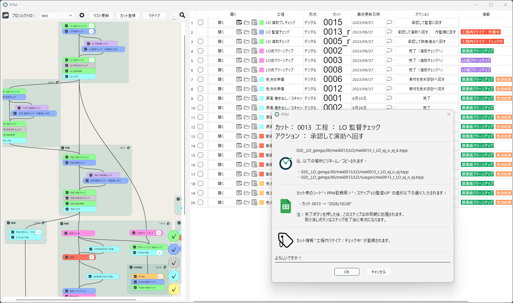

[日本語](index.ja.md)

# PPM Manual

PPM (**P**PM is **P**rogress **M**anager) is a Windows application for managing the progress of animation production.
It looks at the scene files in a shared folder, lists which scene is currently in which workflow,
and performs the file operations needed to move a scene forward (renaming, copying, recording on the scene sheet, and so on) with a single button.

<!-- English screenshot to be made: images/en/home/main-window.png -->

## What is PPM?

### Purpose

In digital animation production, work is often handed over by renaming files or moving them between folders.
For example, a suffix such as `_e` (episode director) or `_k` (series director) is added to the end of a file or folder name to mark that a check is done, or to show who checks it next.

This approach is easy to start with, but it tends to cause problems such as:

- Mistakes in the renaming or copying procedure (forgetting a suffix, adding it twice, putting the file in the wrong folder)
- You cannot tell which scenes are yours without browsing through the folders
- You cannot trace afterwards who moved which workflow forward, and when

PPM lets you define these "handover by files" rules for each project and leaves the procedure to the software.
This reduces mistakes and makes the progress visible.

### Features

- **The files themselves are the progress**: No dedicated server or database is needed.
  PPM determines which workflow each scene is in from the names and locations of its files.
  Even without PPM, you can see the progress by looking at the files in Explorer.
- **Move a scene forward with a single button**: Pressing a button such as "Approve and pass to the director" runs
  a predefined procedure (renaming, copying, filling in the scene sheet, creating a file that marks the next workflow, and so on) after a confirmation dialog.
- **List only the scenes you are in charge of**: Select a workflow or a workflow group to list the scenes in it.
  You can also open the files, the scene folder, and the timesheet (XDTS) of each scene from the list.
- **See the whole flow**: The workflows are shown as a flowchart, together with the number of scenes in each workflow.
- **History is recorded**: For each scene, a log records who did which operation, and when.
- **Retake support**: A scene that received a retake can be sent back to a workflow with a take number.
- **Design the pipeline yourself**: The workflows, the file naming rules, and the procedure run by each button
  can be built for each production in the Project Settings dialog. No programming is required.
- **Integration with external services**: PPM can write progress to Google Sheets and send notifications to Google Chat.

## How to read this manual

People involved with PPM fall into three main roles. We recommend reading the chapters in the following order according to your role.

| Role | Who | Recommended reading |
|---|---|---|
| Staff | Episode directors, directors, animation directors, assistant directors, animators, ink and paint staff, production assistants, and others who move scenes forward in PPM every day | [1. Getting Started](getting-started/installation.md) → [2. How PPM Works](concepts/glossary.md) → [3. Using PPM](using/main-window.md) |
| Pipeline designer | The person who decides the workflows and file naming rules of a production and creates the PPM project | In addition to the above → [4. Creating a Project](designing/overview.md) → [5. Integrations and Advanced Topics](integrations/google-spreadsheet.md) → [7. Reference](reference/steps.md) |
| Administrator | The person who introduces PPM to the studio and manages the shared folders and the settings of each PC | [1. Getting Started](getting-started/installation.md) → [6. Deployment and Administration](administration/stuff-folder.md) |

If you are new to PPM, whatever your role, start by moving a sample scene in the [Tutorial](getting-started/tutorial.md).
If you run into trouble, see [Troubleshooting and FAQ](troubleshooting.md).

## Contents

### 1. Getting Started

- [Installation](getting-started/installation.md)
- [Initial Setup](getting-started/initial-setup.md)
- [Tutorial: Moving a Scene Through the Pipeline](getting-started/tutorial.md)

### 2. How PPM Works

- [Glossary](concepts/glossary.md)
- [Progress Is Managed by Files](concepts/progress-files.md)
- [How Scenes Flow Through Workflows](concepts/scene-flow.md)
- [Working with Files Directly](concepts/working-with-files.md)

### 3. Using PPM (for Staff)

- [Main Window](using/main-window.md)
- [Which Scenes Appear in the List](using/scene-list.md)
- [Working on a Scene](using/scene-operations.md)
- [Registering Scenes](using/registering-scenes.md)
- [Scene Info Tags](using/scene-info.md)
- [Retakes](using/retakes.md)
- [Preferences](using/preferences.md)

### 4. Creating a Project (for Pipeline Designers)

- [Design Process and Preparation](designing/overview.md)
- [Basics](designing/basics.md)
- [Path Macros](designing/path-macros.md)
- [Workflow Groups](designing/workflow-groups.md)
- [Scene Info Tags](designing/info-tags.md)
- [Designing Workflows](designing/workflows.md)
- [Saving and Testing a Project](designing/saving-and-testing.md)
- [Changing the Design During Production](designing/changing-in-production.md)

### 5. Integrations and Advanced Topics

- [Google Spreadsheet Integration](integrations/google-spreadsheet.md)
- [Google Chat Notification](integrations/google-chat.md)
- [Rename Scripts](integrations/rename-scripts.md)
- [Adding Next Workflows Conditionally](integrations/add-progress.md)

### 6. Deployment and Administration

- [The Stuff Folder](administration/stuff-folder.md)
- [Running PPM on a Shared Folder](administration/shared-operation.md)
- [Backup and Recovery](administration/backup.md)
- [UI Language and Translation Files](administration/translations.md)

### 7. Reference

- [Steps](reference/steps.md)
- [Macros](reference/macros.md)
- [File Formats](reference/file-formats.md)

### 8. Troubleshooting

- [Troubleshooting and FAQ](troubleshooting.md)

### 9. About

- [License](about/license.md)
- [Reporting Bugs and Requests](about/reporting-issues.md)
- [Contributing](about/contributing.md)
- [Changelog](about/changelog.md)
