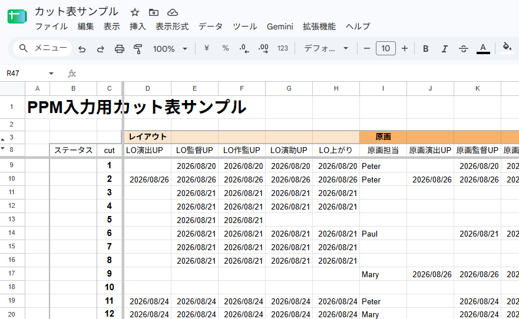
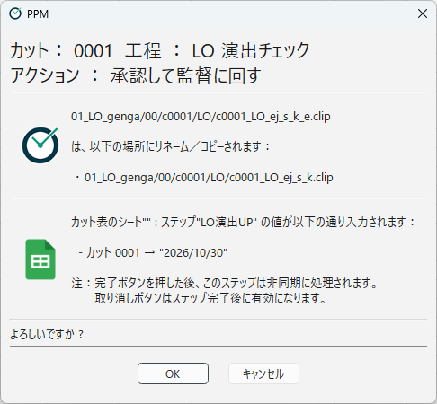

[English](google-spreadsheet.md)

# Google スプレッドシート連携

アクションを実行したときに、Google スプレッドシートのカット表に、日付や担当者の名前などを書き込めます。
たとえば「原画 演出チェック」を承認したときに、カット表の「演出チェック」の列に、その日の日付を入れる、といった使い方です。

書き込みは、Google Apps Script（GAS）のウェブアプリを経由して行います。
PPM に同梱しているスクリプト `google_apps_script/Code.gs` を、書き込み先のスプレッドシートに設定して使います。

メインのカット表にPPMから直接書きこむのではなく、PPMから入力する項目だけを抜き出したスプレッドシートを別に作り、メインのカット表から参照させる方法が安全です。

> Google の画面の名前や配置は、変わることがあります。見当たらないときは、Google のヘルプも参照してください。

## 想定しているスプレッドシートのレイアウト

スクリプトは、次のようなレイアウトのシートを想定しています。

| 場所 | 内容 |
|---|---|
| 8行目 | 工程名（列の見出し）。D列から右に並べます（例：`LO演出`、`LO監督`、`原画演出`…）。 |
| C列 | カット番号。9行目から下に並べます。 |
| 交わるセル | PPM が値を書き込むセルです。 |

- 8行目の工程名は、行の中で重ならないようにします。PPM は、名前で列を探します。
- C列のカット番号は、接頭辞を付けず、先頭の `0` を除いた形で書きます（カット `0012` なら `12`、`0123b` なら `123b`）。
- 工程名の行と、カット番号の列は、スクリプトの先頭にある `FLOW_NAME_ROW`（既定は `8`）と `SCENE_NUMBER_COLUMN`（既定は `"C"`）で変えられます。

PPM の工程の名前と、シートの工程名は、同じでなくてもかまいません。
どの列に書き込むかは、ステップの設定で指定します（下の「アクションにステップを追加する」を参照）。

## Apps Script のウェブアプリをデプロイする

1. 書き込み先のスプレッドシートを開き、メニューの **拡張機能** ＞ **Apps Script** を選びます。
   スクリプトは、必ずスプレッドシートの中から作ってください（スプレッドシートに紐づいたスクリプトだけが、そのスプレッドシートに書き込めます）。
2. 開いたエディタに、`Code.gs` の内容をすべて貼り付けて、保存します。
3. 必要なら、先頭の `FLOW_NAME_ROW` と `SCENE_NUMBER_COLUMN` を、シートのレイアウトに合わせて書き換えます。
4. 右上の **デプロイ** ＞ **新しいデプロイ** を選びます。
5. 種類に **ウェブアプリ** を選び、次のように設定して **デプロイ** を押します。
   - **次のユーザーとして実行**：自分
   - **アクセスできるユーザー**：全員
6. アクセスの承認を求められたら、画面の指示に従って承認します。
7. 表示された **ウェブアプリの URL** をコピーします。

「アクセスできるユーザー」を「全員」にするのは、PPM が Google アカウントでログインせずにスクリプトを呼び出すためです。
スクリプトは、デプロイした人の権限でスプレッドシートに書き込みます。

### スクリプトを更新したとき

`Code.gs` を新しいものに入れ替えたときは、**デプロイ** ＞ **デプロイを管理** で、今のデプロイを編集し、バージョンに **新バージョン** を選んでデプロイし直します。
こうすると、ウェブアプリの URL は変わりません。
**新しいデプロイ** を作ると URL が変わるので、PPM の設定も書き換えることになります。

## PPM 側でプロジェクトに設定する

### URL を登録する

1. **プロジェクト設定** の **基本情報** を開きます。
2. **Google Apps スクリプトのURL** に、コピーしたウェブアプリの URL を貼り付けます。
3. **保存する** を押します。

URL は画面に表示されず、難読化して保存されます（[基本情報](../designing/basics.ja.md) を参照）。

### アクションにステップを追加する

書き込みたいアクションに、**Googleスプレッドシートに入力** のステップを追加します（[工程を設計する](../designing/workflows.ja.md) を参照）。

| 項目 | 内容 |
|---|---|
| **シート名 (任意)** | 書き込むシートの名前です。空のときは、最初のシートに書き込みます。`[EPISODE]` を使うと、話数ごとにシートを分けられます（例：`#[EPISODE]`）。 |
| **工程名** | 書き込む列の、8行目の工程名です。シートの工程名と一字一句同じにします。 |
| **値** | 書き込む値です（下を参照）。 |

**値** には、例えば次のように書けます。

- 決まった文字列：`済`、`OK` など
- `[CURRENT_DATE]`：実行した日付（`2026/10/30` の形）
- `[USER_NAME]`：環境設定のユーザー名
- セミコロン（`;`）で区切った複数の値（例：`OK;NG;保留`）：アクションの確認画面に選択肢が表示され、実行する人が書き込む値を選びます。

### 書き込まれるカット

- 通常は、アクションを実行したカットの行に書き込みます。
- 兼用カット（`0010_0011` など）では、`10` と `11` のそれぞれの行に書き込みます。
- カット情報「バンク」（ID名 `BANK`）が付いているカットでは、バンクの元のカットの行にも書き込みます（[カット情報](../designing/info-tags.ja.md) を参照）。
- シートに行がないカットには、何も書き込みません。

## 実行したときの動き

アクションの確認画面には、どのシートのどの列に、どのカットの値として何が書き込まれるかが表示されます。

- 書き込みは、**OK** を押した後に、裏で行われます。書き込みが終わるまで、行の **取り消す** ボタンは「お待ちください...」と表示されて押せません。
- 書き込みに失敗すると、ボタンは「取り消す (*)」と表示されます。
- **取り消す** と、書き込む前の値に戻します。
- 書き込みが終わる前に PPM を終了しようとすると、確認のメッセージが表示されます（[メイン画面](../using/main-window.ja.md) を参照）。
- **Google Apps スクリプトのURL** が空のプロジェクトでは、このステップは飛ばされます。

### 書き込みの記録

書き込みの記録は、ログフォルダの `google_spreadsheet_cues` フォルダに残ります。

| ファイル | 内容 |
|---|---|
| `google_spreadsheet.log` | すべての書き込みの記録（受付、開始、成功、失敗）です。 |
| `日時.ini`（例：`261030_1415_22123.ini`） | 書き込み中、または失敗した書き込みの内容です。成功すると消えます。失敗した場合は、失敗した日時と原因が書き込まれて残ります。 |

書き込みに失敗したときは、これらのファイルで原因を確かめ、必要ならスプレッドシートを手で直してください。

## セキュリティに関する注意

ウェブアプリの URL を知っていれば、誰でもスプレッドシートに書き込めてしまいます（Google Chat 通知を設定している場合は、Chat への投稿もできます）。

- URL は、PPM のプロジェクトのファイルに難読化して保存され、プロジェクト設定の画面にも表示されません。それでも、URL をメールやチャットに貼ったり、スクリプトを共有したりしないようにしてください。
- URL が漏れたかもしれないときは、**デプロイを管理** で今のデプロイをアーカイブ（無効に）して、新しいデプロイを作り、PPM の URL を書き換えてください。
- スクリプトは、デプロイした人の Google アカウントの権限で動きます。制作用の共有アカウントなど、退職などで使えなくならないアカウントでデプロイすることをおすすめします。

---

[← 目次に戻る](../index.ja.md)
