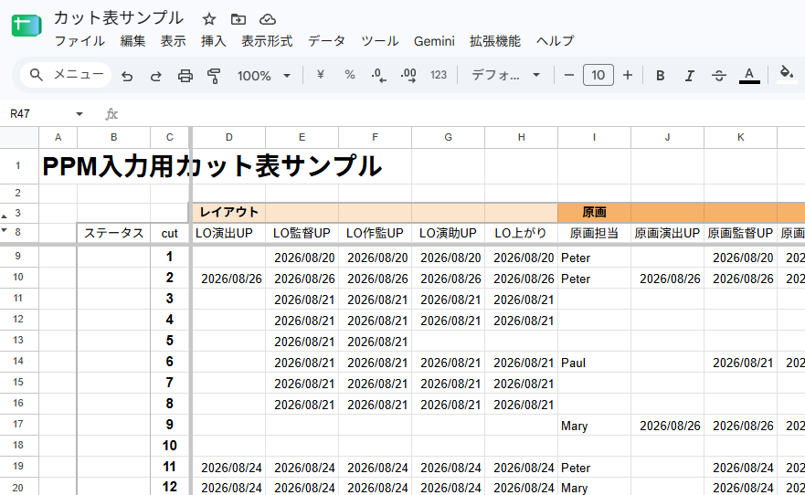
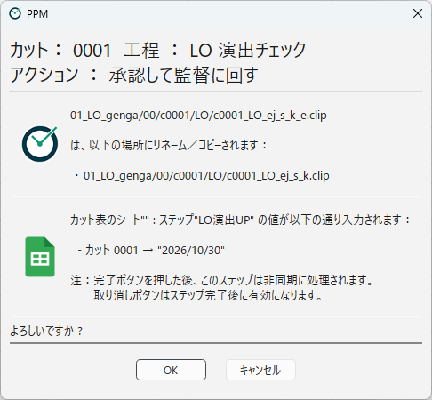

[日本語](google-spreadsheet.ja.md)

# Google Spreadsheet Integration

When an action runs, PPM can write values such as the date or the name of the person in charge into a scene sheet in Google Spreadsheet.
For example, when the key animation episode director check is approved, the date of that day can be entered in the "episode director check" column of the scene sheet.

Values are written through a Google Apps Script (GAS) web app.
Set up the script that comes with PPM, `google_apps_script/Code.gs`, in the spreadsheet you want to write into.

Rather than having PPM write directly into your main scene sheet, it is safer to create a separate spreadsheet that holds only the items PPM fills in, and have the main scene sheet refer to it.

> The names and layout of Google's screens may change. If you cannot find something, also see Google's help.

## The expected spreadsheet layout

The script expects a sheet with the following layout.

| Location | Contents |
|---|---|
| Row 8 | Workflow names (column headers), from column D to the right (e.g. `LO演出`, `LO監督`, `原画演出`, ...). |
| Column C | Scene numbers, from row 9 down. |
| Cells where they cross | The cells PPM writes values into. |

- Workflow names in row 8 must not be repeated within the row. PPM looks for the column by name.
- Write scene numbers in column C without the prefix and without leading `0`s (`12` for scene `0012`, `123b` for `0123b`).
- The row of workflow names and the column of scene numbers can be changed with `FLOW_NAME_ROW` (default `8`) and `SCENE_NUMBER_COLUMN` (default `"C"`) at the top of the script.

The names of PPM workflows and the workflow names in the sheet do not have to be the same.
Which column is written is specified in the step settings (see "Adding a step to an action" below).

## Deploying the Apps Script web app

1. Open the spreadsheet you want to write into, and choose **Extensions** > **Apps Script** from the menu.
   Always create the script from inside the spreadsheet (only a script bound to a spreadsheet can write into it).
2. Paste the whole contents of `Code.gs` into the editor that opens, and save.
3. If needed, change `FLOW_NAME_ROW` and `SCENE_NUMBER_COLUMN` at the top to match the layout of your sheet.
4. Choose **Deploy** > **New deployment** at the top right.
5. Choose **Web app** as the type, set the following, and press **Deploy**.
   - **Execute as**: Me
   - **Who has access**: Anyone
6. If you are asked to authorize access, follow the instructions on the screen to authorize it.
7. Copy the **Web app URL** that is shown.

"Who has access" is set to "Anyone" because PPM calls the script without signing in to a Google account.
The script writes into the spreadsheet with the permissions of the person who deployed it.

### When you update the script

When you replace `Code.gs` with a new version, use **Deploy** > **Manage deployments** to edit the current deployment, choose **New version** as the version, and deploy again.
This way, the web app URL does not change.
If you create a **New deployment**, the URL changes, and you have to change the PPM setting as well.

## Setting up the project in PPM

### Registering the URL

1. Open **Basics** in **Project Settings**.
2. Paste the copied web app URL into **Google Apps Script URL**.
3. Press **Save**.

The URL is not shown on the screen and is saved in an obfuscated form (see [Basics](../designing/basics.md)).

### Adding a step to an action

Add an **Input Google Spreadsheet** step to the action that should write (see [Designing Workflows](../designing/workflows.md)).

| Item | Contents |
|---|---|
| **Sheet Name (optional)** | The name of the sheet to write into. If empty, the first sheet is used. With `[EPISODE]`, you can use a sheet for each episode (e.g. `#[EPISODE]`). |
| **Flow Name** | The workflow name in row 8 of the column to write into. It must be exactly the same as in the sheet. |
| **Value** | The value to write (see below). |

You can write the **Value**, for example, as follows:

- A fixed string: `Done`, `OK`, and so on
- `[CURRENT_DATE]`: The date of execution (in the form `2026/10/30`)
- `[USER_NAME]`: The user name in Preferences
- Several values separated by semicolons (`;`) (e.g. `OK;NG;Pending`): Choices are shown in the action confirmation dialog, and the person running the action chooses the value to write.

### Which scenes are written

- Usually, the value is written in the row of the scene the action runs on.
- For shared scenes (such as `0010_0011`), it is written in each of the rows `10` and `11`.
- For scenes with the "Bank" scene info tag (ID name `BANK`), it is also written in the rows of the bank source scenes (see [Scene Info Tags](../designing/info-tags.md)).
- Nothing is written for scenes that have no row in the sheet.

## What happens when the action runs

The action confirmation dialog shows which value is written into which column of which sheet, for which scenes.

- Writing is done in the background after you press **OK**. Until it is done, the **Undo** button of the row shows **Please Wait ...** and cannot be pressed.
- If writing fails, the button shows **Undo (*)**.
- **Undo** restores the values from before the writing.
- If you try to quit PPM before writing is done, a confirmation message is shown (see [Main Window](../using/main-window.md)).
- In a project whose **Google Apps Script URL** is empty, this step is skipped.

### Records of writing

Records of writing are kept in the `google_spreadsheet_cues` folder of the log folder.

| File | Contents |
|---|---|
| `google_spreadsheet.log` | A record of every write (queued, started, succeeded, failed). |
| `date and time.ini` (e.g. `261030_1415_22123.ini`) | The contents of a write in progress or a failed write. Deleted on success. On failure, the date and time of the failure and the cause are written into it, and it remains. |

When writing fails, check the cause in these files, and fix the spreadsheet by hand if needed.

## Security notes

Anyone who knows the web app URL can write into the spreadsheet (and, if Google Chat notifications are set up, post to Chat).

- The URL is saved in obfuscated form in the PPM project file and is not shown in the Project Settings dialog. Even so, do not paste the URL into emails or chats, and do not share the script.
- If the URL may have leaked, archive (disable) the current deployment in **Manage deployments**, create a new deployment, and change the URL in PPM.
- The script runs with the permissions of the Google account of the person who deployed it. We recommend deploying it with an account that will not become unusable, such as a shared production account, rather than a personal account of someone who may leave.

---

[← Back to contents](../index.md)
