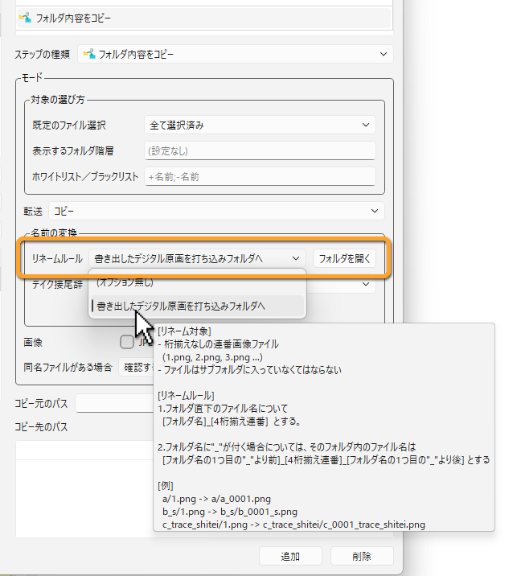

[English](rename-scripts.md)

# リネームスクリプト

**フォルダ内容をコピー** のステップでは、コピーするファイルの名前を、決まったルールで付け替えられます。
このルールを JavaScript で書いたものが、**リネームスクリプト**です。

たとえば、ClipStudioから書き出した連番の画像（`a/1.png`、`a/2.png`…）を、打ち込み用に `a_0001.png`、`a_0002.png`… という名前にしてコピーする、といったことができます。

## スクリプトを置く

リネームスクリプトは、Stuff フォルダの `rename_scripts` フォルダに、拡張子 `.js` のファイルとして置きます。

```
Stuff/
└─ rename_scripts/
   ├─ genga_to_uchikomi.js   … 同梱のサンプル
   └─ my_rule.js
```

- `rename_scripts` フォルダがないときは、PPM が作り、同梱のサンプル `genga_to_uchikomi.js` を置きます。サンプルを消しても、フォルダがある限り、もう一度置かれることはありません。
- Stuff フォルダは全員で共有しているので、ここに置いたスクリプトは、すべての PC で使えます（[Stuff フォルダ](../administration/stuff-folder.ja.md) を参照）。

## スクリプトを選ぶ

**フォルダ内容をコピー** のステップの設定で、**名前の変換** の **リネームルール** から、スクリプトを選びます。
一覧には、スクリプトの中で決めたルールの名前が表示されます。
読み込めないスクリプトには「（エラー）」、見つからないスクリプトには「（見つかりません）」が付きます。

**フォルダを開く** ボタンを押すと、`rename_scripts` フォルダを開けます。



**名前の変換** では、リネームルールのほかに、**テイク接尾辞**、**サブフォルダを展開** も選べます。
複数を選んだ場合は、リネームルール、テイク接尾辞、サブフォルダの展開の順に使われます。
ステップのほかの設定は、[ステップ一覧](../reference/steps.ja.md) で説明します。

### 実行したときの動き

- アクションの確認画面に、使われるルールの名前が表示されます。名前にマウスを重ねると、ルールの説明が表示されます。
- ルールの対象にならないファイルがあると、リネームせずにそのままコピーするか、スキップするかを選ぶメッセージが表示されます。
- スクリプトがエラーを返したときは、ステップが失敗します。

## スクリプトを書く

スクリプトには、ルールの名前と説明を表す `rule` と、名前を付け替える関数 `rename` を書きます。

```javascript
var rule = {
  name: {
    en: "Add the scene number",
    ja: "カット番号を付ける"
  },
  description: {
    en: "1.png -> c0001_0001.png",
    ja: "1.png → c0001_0001.png"
  }
};

function rename(path, context) {
  // 画像ファイルだけが対象
  if (!/\.png$/.test(path))
    return "";
  var fileName = path.split("/").pop();
  var number = fileName.replace(".png", "");
  while (number.length < 4)
    number = "0" + number;
  return "c" + context.sceneNumber + "_" + number + ".png";
}
```

### rule

| 項目 | 内容 |
|---|---|
| `name` | ルールの名前です。**リネームルール** の一覧と、確認画面に表示されます。 |
| `description` | ルールの説明です。確認画面で、ルールの名前にマウスを重ねると表示されます。 |

どちらも、文字列か、言語ごとの文字列（`en`、`ja` など）を書きます。
PPM の表示言語の文字列がない場合は、最初に書いた文字列が使われます。
`rule` を書かない場合は、ファイル名（拡張子を除く）が名前になります。

### rename(path, context)

コピーするファイルごとに呼ばれます。

- **path**：コピー元のフォルダからの、ファイルの相対パスです。サブフォルダに入っているファイルは、`a/1.png` のようにフォルダを含みます。区切りは `/` です。
- **context**：カットの情報です。`context.sceneNumber`（カット番号）、`context.sequence`（シークエンス）、`context.episode`（話数）が入っています。使わなくてもかまいません。
- **戻り値**：コピー先のフォルダからの、新しい相対パスを返します。サブフォルダに入れる場合は、`a/a_0001.png` のようにフォルダを含めます。
  ルールの対象にしないファイルには、空の文字列（`""`）を返します（何も返さない場合も、対象外になります）。

次のような戻り値は、エラーになります。

- 文字列以外の値
- 絶対パス（`C:/...`、`/...`）や、コピー先のフォルダの外に出るパス（`../...`）

### 決まりと制限

- スクリプトからは、ファイルやネットワークにはアクセスできません。名前の計算だけを行います。
- 読み込みに5秒以上、1回のコピーで全ファイルの名前を計算するのに30秒以上かかると、止められてエラーになります。
- スクリプトに書き間違いがあると、エラーの行番号が表示されます。
- 文字コードは UTF-8 で保存してください。

### 同梱のサンプル

`genga_to_uchikomi.js`（書き出したデジタル原画を打ち込みフォルダへ）は、次のようにリネームします。

```
a/1.png               → a/a_0001.png
b_s/1.png             → b_s/b_0001_s.png
c_trace_shitei/1.png  → c_trace_shitei/c_0001_trace_shitei.png
```

- 対象は、サブフォルダの直下にある、数字で始まる画像ファイルです。
- 番号は4けたに揃えます。
- フォルダ名に `_` が含まれる場合は、最初の `_` より後ろの部分を、番号の後ろに付けます。

自分たちのルールを作るときの、書き方の見本として使ってください。

---

[← 目次に戻る](../index.ja.md)
