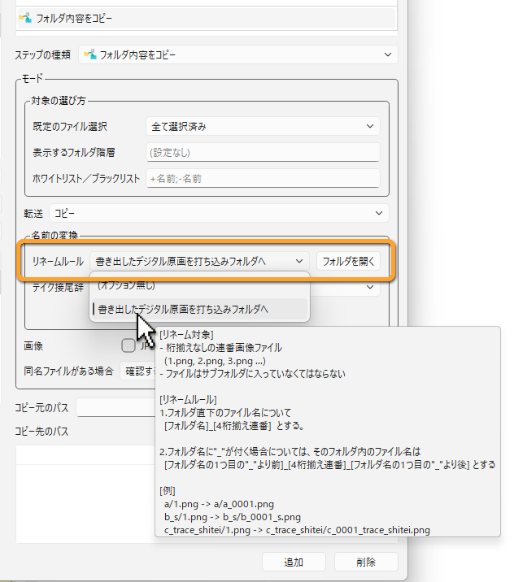

[日本語](rename-scripts.ja.md)

# Rename Scripts

The **Copy Folder Contents** step can rename the files it copies according to a fixed rule.
A **rename script** is such a rule written in JavaScript.

For example, sequentially numbered images exported from Clip Studio (`a/1.png`, `a/2.png`, ...) can be copied with names for compositing input, such as `a_0001.png`, `a_0002.png`, ...

## Placing scripts

Put rename scripts as `.js` files in the `rename_scripts` folder of the Stuff folder.

```
Stuff/
└─ rename_scripts/
   ├─ genga_to_uchikomi.js   … the bundled sample
   └─ my_rule.js
```

- If the `rename_scripts` folder does not exist, PPM creates it and puts the bundled sample `genga_to_uchikomi.js` in it. If you delete the sample, it is not put back as long as the folder exists.
- The Stuff folder is shared by everyone, so scripts put here can be used on every PC (see [The Stuff Folder](../administration/stuff-folder.md)).

## Choosing a script

In the settings of the **Copy Folder Contents** step, choose a script from **Rename Rule** under **Name Conversion**.
The list shows the rule names defined in the scripts.
Scripts that cannot be loaded are marked "(error)", and scripts that cannot be found are marked "(not found)".

Press the **Open Folder** button to open the `rename_scripts` folder.



Besides the rename rule, **Name Conversion** also offers **Take Suffix** and **Flatten subfolders**.
When several are selected, they are applied in this order: rename rule, take suffix, flattening subfolders.
The other settings of the step are explained in [Steps](../reference/steps.md).

### What happens when the action runs

- The action confirmation dialog shows the name of the rule used. Hover over the name to show the description of the rule.
- If some files are not targets of the rule, a message asks whether to copy them without renaming or skip them.
- If the script returns an error, the step fails.

## Writing a script

In a script, write `rule`, which gives the name and description of the rule, and the function `rename`, which changes the names.

```javascript
var rule = {
  name: {
    en: "Add the scene number",
    ja: "カット番号を付ける"
  },
  description: {
    en: "1.png -> c0001_0001.png",
    ja: "1.png → c0001_0001.png"
  }
};

function rename(path, context) {
  // Only image files are targets
  if (!/\.png$/.test(path))
    return "";
  var fileName = path.split("/").pop();
  var number = fileName.replace(".png", "");
  while (number.length < 4)
    number = "0" + number;
  return "c" + context.sceneNumber + "_" + number + ".png";
}
```

### rule

| Item | Contents |
|---|---|
| `name` | The name of the rule. Shown in the **Rename Rule** list and in the confirmation dialog. |
| `description` | The description of the rule. Shown when you hover over the rule name in the confirmation dialog. |

Write each as a string, or as strings for each language (`en`, `ja`, and so on).
If there is no string for the display language of PPM, the first string is used.
If you do not write `rule`, the file name (without the extension) is used as the name.

### rename(path, context)

Called for each file to be copied.

- **path**: The path of the file relative to the source folder. For a file in a subfolder, it includes the folder, like `a/1.png`. The separator is `/`.
- **context**: Information about the scene. It contains `context.sceneNumber` (scene number), `context.sequence` (sequence), and `context.episode` (episode). You do not have to use it.
- **Return value**: Return the new path relative to the destination folder. To put the file in a subfolder, include the folder, like `a/a_0001.png`.
  For a file that is not a target of the rule, return an empty string (`""`) (returning nothing also makes it a non-target).

The following return values cause an error:

- Values other than strings
- Absolute paths (`C:/...`, `/...`) and paths that go outside the destination folder (`../...`)

### Rules and limits

- Scripts cannot access files or the network. They only compute names.
- If loading takes 5 seconds or more, or computing the names of all files in one copy takes 30 seconds or more, the script is stopped with an error.
- If the script has a mistake, the line number of the error is shown.
- Save scripts in UTF-8.

### The bundled sample

`genga_to_uchikomi.js` ("Exported Genga images to Uchikomi folder") renames files as follows.

```
a/1.png               → a/a_0001.png
b_s/1.png             → b_s/b_0001_s.png
c_trace_shitei/1.png  → c_trace_shitei/c_0001_trace_shitei.png
```

- The targets are image files that start with a number, directly inside a subfolder.
- Numbers are padded to 4 digits.
- If the folder name contains `_`, the part after the first `_` is added after the number.

Use it as an example of how to write your own rules.

---

[← Back to contents](../index.md)
