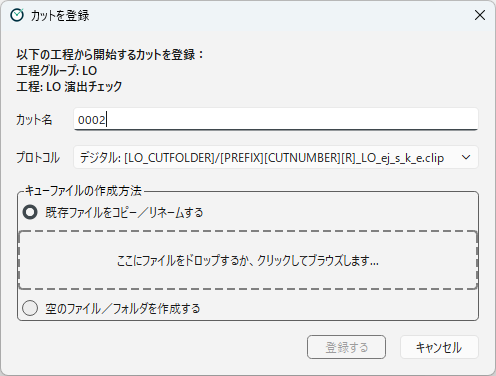
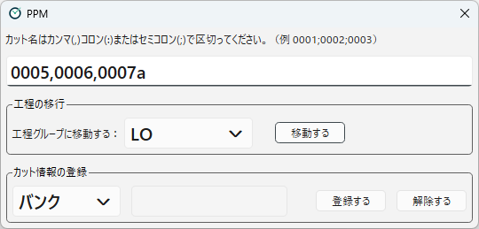

[English](registering-scenes.md)

# カットの登録

カットを PPM で管理するには、カットを工程グループに**登録**します。
登録の方法は2つあります。

| 方法 | すること | 使う場面 |
|---|---|---|
| 工程を右クリックして **この工程から始めるカットを登録する** | 1つのカットを、工程グループに登録し、その工程のキューファイルを作ります。 | 新しいカットを流し始めるとき、途中の工程からカットを乗せるとき |
| 上部の **カット登録** ボタン | 複数のカットの所属を、まとめて別の工程グループに移します。カット情報の付け外しもここで行います。 | まだキューファイルの無いカットをまとめて登録だけするとき、所属している工程グループを直すとき、カット情報を付けるとき |

## この工程から始めるカットを登録する

工程を指定して、そこから流れ始めるカットを1つ登録します。
チュートリアルの最後でも、この方法を使っています。

1. 左側で、カットを始めたい工程を右クリックし、**この工程から始めるカットを登録する** を選びます。
   一覧表示でも、フローチャート表示でも使えます。
2. **カットを登録** の画面で、次の項目を入れます。
3. **登録する** を押します。
4. 確認画面で内容を確かめて、**OK** を押します。

| 項目 | 内容 |
|---|---|
| **カット名** | 登録するカット名です（例：`0123b`）。 |
| **プロトコル** | その工程のどのプロトコルとして登録するかを選びます。形式と条件パスが表示されます。 |
| **キューファイルの作成方法** | キューファイルをどう用意するかを選びます（下を参照）。 |

### キューファイルの作成方法

- **既存ファイルをコピー／リネームする**：手元にあるファイルを、キューファイルの名前でカットフォルダにコピーします。
  点線の枠にファイルをドラッグ＆ドロップするか、枠をクリックしてファイルを選びます。
  ファイルの拡張子に合うプロトコルがあれば、**プロトコル** が自動で切り替わります。
- **空のファイル／フォルダを作成する**：空のファイルをキューファイルとして作ります。条件パスに拡張子がない場合は、空のフォルダを作ります。
  テキストファイル（`.txt`）を条件パスにしたプロトコルがあれば、自動でそれが選ばれます。

キューファイルと同じ名前のファイルやフォルダが、すでにカットフォルダにある場合は、確認画面にそのことが表示されます。

- **既存ファイルをコピー／リネームする** の場合は、既存のファイルが上書きされます。上書きしたくない場合は、確認画面で **Cancel** を押します。
- **空のファイル／フォルダを作成する** の場合は、既存のファイルやフォルダをそのまま残し、キューファイルとして使います。

### すでに別の工程にいるカットを登録したとき

登録するカットが、すでに **別の工程グループ** の工程にいる場合は、確認画面で次のどれかを選びます（主流と傍流については、[用語集](../concepts/glossary.ja.md) の「傍流」を参照）。

| 選択肢 | カットの所属 | 元の工程の記録 |
|---|---|---|
| **差し替える** | 登録先の工程グループに移ります。元の工程グループからは外れます（傍流として所属していた場合も外れます）。 | 外れます。 |
| **追加登録する（元の工程グループに残る）** | 元の工程グループに残り、登録先の工程グループが傍流として加わります。 | 残ります。 |
| **追加登録する（登録先に移り、元を傍流にする）** | 登録先の工程グループに移り、元の工程グループは傍流として残ります。 | 残ります。 |

登録するカットが、すでに **同じ工程グループ** のほかの工程にいる場合は、選択肢は表示されません。
どの工程に並ぶかは、カットフォルダにあるキューファイルで決まります。
前の工程に並べたくない場合は、前の工程のキューファイルが残っていないか確かめてください。

登録が終わると、登録先（と、カットが元いた工程グループ）について、工程グループの更新ボタンと同じ処理が自動で行われます。
そのため、所属している工程グループの中で、どの工程に並ぶかは、いずれの場合もキューファイルで決まります。

### カット名の決まり

プロジェクト設定でシークエンスを使う場合は、カット名は3けた以上の数字で始まる必要があります（`0123`、`0123b` など）。
使えないカット名を入れると、赤字で理由が表示され、**登録する** ボタンが押せなくなります。

## カット登録 ボタン

上部の **カット登録** ボタンを押すと、カットの所属とカット情報を変える画面が開きます。

一番上の欄に、対象のカット名を入れます。
複数のカットを、カンマ（`,`）、コロン（`:`）、セミコロン（`;`）で区切って、まとめて入れられます（例：`0001;0002;0003`）。

### 工程グループを移す

**工程の移行** の **工程グループに移動する** で移動先の工程グループを選び、**移動する** を押します。
カットの所属が、選んだ工程グループに移ります。
ログには「工程グループ「〇〇」に移動する」と記録されます。

- 通常の工程グループどうし、リテイク用の工程グループ（とリテイク発行元の工程グループ）どうしで、所属が切り替わります。
- この操作では、キューファイルは作られません。移動先の工程のキューファイルがカットフォルダにない場合は、別に用意してください。
- 移動が終わると、移動先（と、カットが元いた工程グループ）について、工程グループの更新ボタンと同じ処理が自動で行われます。移動先の工程のキューファイルがあれば、その工程にカットが並びます（[カットがリストに並ぶ条件](scene-list.ja.md) を参照）。

### カット情報を付け外しする

**カット情報の登録** で、カット情報を付けたり外したりします。
詳しくは [カット情報](scene-info.ja.md) を参照してください。

---

[← 目次に戻る](../index.ja.md)
