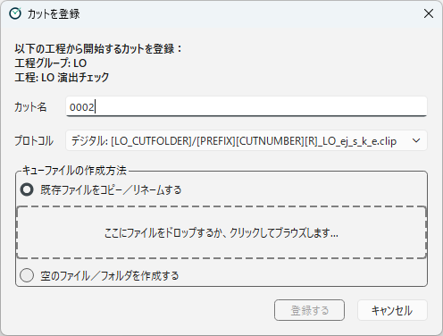
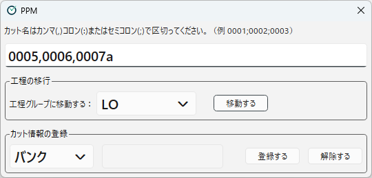

[日本語](registering-scenes.ja.md)

# Registering Scenes

To manage a scene in PPM, **register** it to a workflow group.
There are two ways to register scenes.

| Method | What it does | When to use it |
|---|---|---|
| Right-click a workflow and choose **Register a scene starting from this workflow** | Registers one scene to a workflow group and creates the cue file of that workflow. | When starting a new scene, or putting a scene in at a workflow in the middle |
| The **Register** button at the top | Moves several scenes to another workflow group at once. Scene info tags are also set and removed here. | When only registering several scenes that have no cue files yet, when fixing the workflow group a scene belongs to, or when attaching scene info tags |

## Register a scene starting from this workflow

Specify a workflow and register one scene that starts from there.
The end of the tutorial also uses this method.

1. On the left, right-click the workflow where you want the scene to start, and choose **Register a scene starting from this workflow**.
   This works in both the list view and the flowchart view.
2. In the **Register a Scene** dialog, fill in the following items.
3. Press **Register**.
4. Check the contents in the confirmation dialog and press **OK**.

<!-- English screenshot to be made: images/en/getting-started/tutorial-register-scene.png -->

| Item | Contents |
|---|---|
| **Scene Name** | The name of the scene to register (e.g. `0123b`). |
| **Protocol** | Which protocol of the workflow to register the scene as. The media and the condition path are shown. |
| **Cue File Creation Method** | How to prepare the cue file (see below). |

### Cue file creation method

- **Copy/rename an existing file**: Copies a file you have into the scene folder with the name of the cue file.
  Drag and drop a file onto the dashed frame, or click the frame to choose a file.
  If there is a protocol that matches the extension of the file, **Protocol** is switched automatically.
- **Create an empty file/folder**: Creates an empty file as the cue file. If the condition path has no extension, an empty folder is created.
  If there is a protocol whose condition path is a text file (`.txt`), it is selected automatically.

If a file or folder with the same name as the cue file already exists in the scene folder, the confirmation dialog says so.

- With **Copy/rename an existing file**, the existing file is overwritten. If you do not want to overwrite it, press **Cancel** in the confirmation dialog.
- With **Create an empty file/folder**, the existing file or folder is kept as it is and used as the cue file.

### Registering a scene that is already in another workflow

If the scene is already in a workflow of **another workflow group**, choose one of the following in the confirmation dialog (for main flows and branch flows, see "Branch flow" in the [Glossary](../concepts/glossary.md)).

| Choice | Workflow group of the scene | Record of the current workflow |
|---|---|---|
| **Replace** | The scene moves to the destination workflow group, and leaves its current workflow group (including when it belongs to it as a branch flow). | Removed. |
| **Add (stay in the current workflow group)** | The scene stays in its current workflow group, and the destination workflow group is added as a branch flow. | Kept. |
| **Add (move to the destination, and keep the current one as a branch flow)** | The scene moves to the destination workflow group, and its current workflow group is kept as a branch flow. | Kept. |

If the scene is already in another workflow of **the same workflow group**, no choice is shown.
Which workflows the scene is listed in depends on the cue files in the scene folder.
If you do not want the scene listed in the previous workflow, check that the cue file of the previous workflow is not left.

After registration, the same process as the reload button of a workflow group is run automatically for the destination workflow group (and the workflow group the scene was in).
So, in every case, which workflows of its workflow groups the scene is listed in depends on the cue files.

### Rules for scene names

If the project uses sequences, scene names must begin with a number of three or more digits (`0123`, `0123b`, and so on).
If you enter a scene name that cannot be used, the reason is shown in red, and the **Register** button cannot be pressed.

## The Register button

Press the **Register** button at the top to open a dialog for changing the workflow group and the scene info tags of scenes.

<!-- English screenshot to be made: images/en/using/register-dialog.png -->

Enter the target scene names in the field at the top.
You can enter several scenes at once, separated by commas (`,`), colons (`:`), or semicolons (`;`) (e.g. `0001;0002;0003`).

### Moving to another workflow group

In **Move Workflow**, choose the destination in **Move to the flow group :** and press **Move**.
The scenes move to the selected workflow group.
The log records "Move to the flow group (group name)".

- The workflow group is switched among the normal workflow groups, or among the workflow groups for retakes (and the retake source workflow groups).
- This operation does not create cue files. If the scene folder has no cue file for the destination workflow, prepare it separately.
- After moving, the same process as the reload button of a workflow group is run automatically for the destination workflow group (and the workflow group the scene was in). If there is a cue file of a workflow of the destination, the scene is listed in that workflow (see [Which Scenes Appear in the List](scene-list.md)).

### Setting and removing scene info tags

Use **Register Info** to set and remove scene info tags.
See [Scene Info Tags](scene-info.md) for details.

---

[← Back to contents](../index.md)
