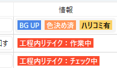
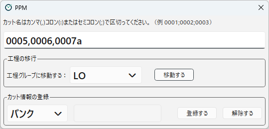

[English](scene-info.md)

# カット情報

**カット情報**は、「バンク」「BG Only」「工程内リテイク：作業中」のように、カットに付ける印（タグ）です。
どんなカット情報を使うかは、プロジェクトごとにプロジェクト設定で決めます（[カット情報（プロジェクト設定）](../designing/info-tags.ja.md) を参照）。

## カット情報を見る

カット情報は、次の場所に表示されます。

- **カットの一覧の「情報」の列**：カット情報が、色付きのラベルで並びます。
- **カット検索の「カット情報」**：上部の **カット番号を入力** の欄でカットを検索すると、表示されます（[メイン画面](main-window.ja.md) を参照）。

値を持つカット情報は、ラベルの後ろに値が表示されます（例：`バンク:0010, 0020`）。

## カット情報の種類

カット情報には、次の種類があります。

| 種類 | 内容 | サンプルの例 |
|---|---|---|
| オン／オフ（真偽値） | 付いているか、いないかだけを表します。 | BG Only |
| 文字列 | 1つの値を持ちます。 | リテイク作業中 |
| 文字列のリスト（文字列リスト） | 複数の値を持ちます。 | バンク（バンク元のカット番号を入れる） |
| 選択肢（列挙型） | 決められた値のどれか1つを持ちます。値ごとに、別のラベルと色で表示されます。 | 工程内リテイク（作業中／チェック中） |

（ ）の中は、プロジェクト設定での形式の名前です（[カット情報（プロジェクト設定）](../designing/info-tags.ja.md) を参照）。

また、カット情報には、**手で付け外しできるもの**と、**アクションのステップで自動的に付け外しされるもの**があります。
サンプルでは、「バンク」と「BG Only」は手で付け外しでき、「リテイク作業中」と「工程内リテイク」は PPM が自動で付け外しします。
自動で付け外しされるカット情報は、手では変えられません。

## カット情報を付け外しする

手で付け外しできるカット情報は、上部の **カット登録** ボタンで開く画面の **カット情報の登録** で変えます。

1. 一番上の欄に、対象のカット名を入れます。カンマ（`,`）、コロン（`:`）、セミコロン（`;`）で区切って、複数のカットをまとめて入れられます。
2. 左のリストから、カット情報を選びます。選択肢の種類のカット情報は、値ごとにリストに並びます。
3. 値を持つカット情報（文字列、文字列のリスト）の場合は、右の欄に値を入れます。文字列のリストは、カンマ、コロン、セミコロンで区切って複数の値を入れられます。
4. **登録する** を押すと付き、**解除する** を押すと外れます。

選択肢の種類のカット情報を **解除する** ときは、今付いている値と同じものをリストで選んでください。違う値を選ぶと、外れません。
値を持つカット情報（文字列、文字列のリスト）は、右の欄の値にかかわらず、カット情報ごと外れます。文字列のリストから一部の値だけを外すことはできません。

カット情報を付け外しすると、ログに「カット情報の変更」として記録されます。
変更は、**リスト更新** を押すと一覧に反映されます。

---

[← 目次に戻る](../index.ja.md)
