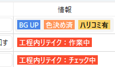
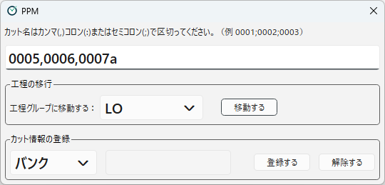

[日本語](scene-info.ja.md)

# Scene Info Tags

**Scene info tags** are marks attached to a scene, such as "Bank", "BG Only", or "Rewind: WIP".
Which scene info tags are used is decided for each project in the project settings (see [Scene Info Tags (Project Settings)](../designing/info-tags.md)).

## Viewing scene info tags

Scene info tags are shown in the following places:

- **The "Information" column of the scene list**: Scene info tags are shown as colored labels.
- **"Scene Info Tags" in the scene search**: Shown when you search for a scene in the **Scene Number** field at the top (see [Main Window](main-window.md)).

For a scene info tag that has a value, the value is shown after the label (e.g. `Bank:0010, 0020`).

<!-- English screenshot to be made: images/en/using/scene-info-labels.png -->

## Types of scene info tags

There are the following types of scene info tags.

| Type | Contents | Example in the sample |
|---|---|---|
| On/off (Bool) | Only shows whether it is attached or not. | BG Only |
| String | Has one value. | リテイク作業中 (retake in progress) |
| String list (String List) | Has several values. | バンク (Bank; enter the scene numbers of the bank source) |
| Choice (Enum) | Has one of the predefined values. Each value is shown with its own label and color. | 工程内リテイク (Rewind; WIP / Checking) |

The names in parentheses are the type names in the project settings (see [Scene Info Tags (Project Settings)](../designing/info-tags.md)).

Also, some scene info tags **can be set and removed by hand**, and others **are set and removed automatically by action steps**.
In the sample, "Bank" and "BG Only" can be set and removed by hand, and "retake in progress" and "Rewind" are set and removed automatically by PPM.
Scene info tags that are set and removed automatically cannot be changed by hand.

## Setting and removing scene info tags

Scene info tags that can be set by hand are changed in **Register Info** in the dialog opened with the **Register** button at the top.

<!-- English screenshot to be made: images/en/using/register-dialog.png -->

1. Enter the target scene names in the field at the top. You can enter several scenes at once, separated by commas (`,`), colons (`:`), or semicolons (`;`).
2. Choose a scene info tag from the list on the left. For a choice type, each value is listed separately.
3. For a scene info tag that has a value (string or string list), enter the value in the field on the right. For a string list, you can enter several values separated by commas, colons, or semicolons.
4. Press **Register** to set it, or **Release** to remove it.

To **Release** a choice-type scene info tag, choose the same value as the one currently attached. If you choose a different value, it is not removed.
A scene info tag that has a value (string or string list) is removed as a whole, whatever value is in the field on the right. You cannot remove only some of the values of a string list.

Setting or removing a scene info tag is recorded in the log as "Modify Cut Info".
The change is reflected in the list when you press **Refresh**.

---

[← Back to contents](../index.md)
