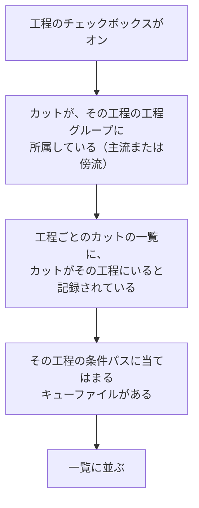

[English](scene-list.md)

# カットがリストに並ぶ条件

カットの一覧に並ぶはずのカットが見つからないときは、このページの条件を順に確かめてください。
仕組みの全体は [進捗はファイルで管理される](../concepts/progress-files.ja.md) で説明しています。

## 一覧に並ぶまでの判定

カットは、次の条件をすべて満たすときに、その工程の行として一覧に並びます。

1. **工程のチェックボックスがオンになっている**：左側で、その工程を選んでいるかを確かめます（[メイン画面](main-window.ja.md) を参照）。
2. **カットが工程グループに所属している**：カットは、所属している工程グループ（主流）と、追加された傍流の工程グループの工程にしか並びません。所属は、[カットの登録](registering-scenes.ja.md) や、アクションのステップで変わります。
3. **工程ごとのカットの一覧に記録されている**：PPM は、どのカットがどの工程にいるかを記録しておき、一覧を作るときは、記録に載っているカットだけを調べます。この記録は、アクションを実行したとき、工程グループの更新ボタンを押したとき、カットを登録したり工程グループを移したりしたとき、リテイクを出したときに書き換わります。
4. **キューファイルがある**：記録に載っているカットについて、その工程の条件パスに当てはまるファイルが本当にあるかを確かめます。ファイルがなければ、記録に載っていても並びません。

工程に複数のプロトコルがある場合は、上から順に条件パスを確かめ、最初に当てはまったプロトコルの行として並びます。
兼用カット（`0150_0152` など）は、カット名をつないだファイル名のほかに、`0150`・`0152` のように個別のカット番号のファイル名でも探します。

## リスト更新と、工程グループの更新ボタン

一覧を作り直すボタンは2種類あります。

| ボタン | すること | 押すとき |
|---|---|---|
| **リスト更新**（上部） | 工程グループの所属を読み直し、記録に載っているカットについて、キューファイルを確かめ直します。 | ほかの人がアクションを実行した後や、アクションを実行して灰色になった行を片付けたいとき |
| **更新ボタン**（工程グループの回転矢印のアイコン） | その工程グループに所属しているすべてのカットについて、すべての工程のキューファイルを探し直し、工程ごとのカットの一覧を作り直します。 | ファイルを手で置いたり動かしたりした後 |

工程グループの更新ボタンは、ファイルを探すのに時間がかかることがあります。
ふだんは **リスト更新** を使い、カットが並ぶはずの工程に並ばないときに、工程グループの更新ボタンを押してください。

## カットが並ばないときは

| 状況 | 確かめること |
|---|---|
| どの工程にも並ばない | カットが工程グループに所属しているか（**カット検索** の「工程グループ」を見ます）。所属していなければ、[カットの登録](registering-scenes.ja.md) で登録します。 |
| ファイルを置いたのに並ばない | ファイル名が条件パスに合っているか（工程にマウスを重ねると、条件パスが表示されます）。合っていれば、工程グループの更新ボタンを押します。 |
| 別の人が進めたはずのカットが、前の工程に残っている | **リスト更新** を押します。 |
| 同じカットが2つの工程に並ぶ | 前の工程のキューファイルが残っていないか。工程グループの更新ボタンを押すと、キューファイルが残っている工程すべてに並びます。カットフォルダを開いて確かめます。 |
| 話数を使うプロジェクトで並ばない | 上部の **話数** で、正しい話数を選んでいるか。 |

ファイルを手で直すときの考え方は、[ファイルを直接扱う](../concepts/working-with-files.ja.md) を参照してください。

---

[← 目次に戻る](../index.ja.md)
