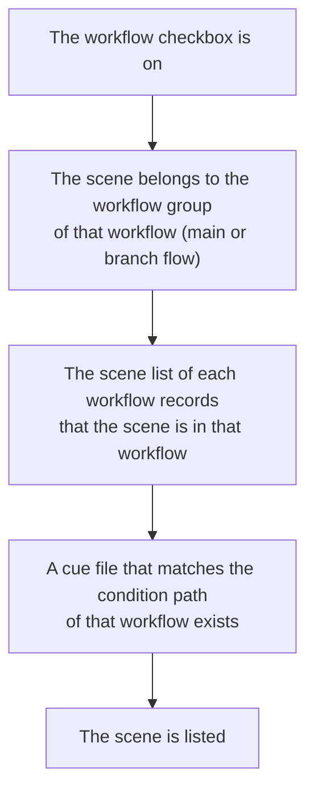

[日本語](scene-list.ja.md)

# Which Scenes Appear in the List

If a scene that should be in the scene list cannot be found, check the conditions on this page in order.
The overall mechanism is explained in [Progress Is Managed by Files](../concepts/progress-files.md).

## How PPM decides what to list

A scene is listed as a row of a workflow when all of the following conditions are met.

1. **The workflow checkbox is on**: Check that the workflow is selected on the left (see [Main Window](main-window.md)).
2. **The scene belongs to the workflow group**: A scene is only listed in the workflows of the workflow group it belongs to (the main flow) and of the workflow groups it has been added to as branch flows. The workflow group changes through [Registering Scenes](registering-scenes.md) or action steps.
3. **The scene list of each workflow records it**: PPM keeps a record of which scene is in which workflow, and when building the list, it only checks the scenes in this record. The record is rewritten when you run an action, when you press the reload button of a workflow group, when you register a scene or move it to another workflow group, and when you issue a retake.
4. **The cue file exists**: For each scene in the record, PPM checks that a file matching the condition path of the workflow really exists. If not, the scene is not listed even if it is in the record.

If a workflow has several protocols, their condition paths are checked from the top, and the scene is listed as a row of the first protocol that matches.
For a shared scene (such as `0150_0152`), PPM looks for files named with the joined scene name, and also for files named with each scene number, such as `0150` and `0152`.

## Refresh and the reload button of a workflow group

There are two buttons that rebuild the list.

| Button | What it does | When to press it |
|---|---|---|
| **Refresh** (at the top) | Reads the workflow group membership again, and checks the cue files again for the scenes in the record. | After someone else has run an action, or to clear the rows that turned gray after you ran actions |
| **Reload button** (the circular arrow icon of a workflow group) | Looks for the cue files of all workflows again for all the scenes that belong to the workflow group, and rebuilds the scene list of each workflow. | After placing or moving files by hand |

The reload button of a workflow group may take time to look for files.
Usually use **Refresh**, and press the reload button of the workflow group when a scene does not appear in the workflow where it should be.

## If a scene does not appear

| Situation | What to check |
|---|---|
| The scene is not listed in any workflow | Whether the scene belongs to a workflow group (see "Main Flow Group" in the **scene search**). If not, register it with [Registering Scenes](registering-scenes.md). |
| You placed a file, but the scene is not listed | Whether the file name matches the condition path (hover the mouse over the workflow to see its condition paths). If it does, press the reload button of the workflow group. |
| A scene that someone else moved forward is still in the previous workflow | Press **Refresh**. |
| The same scene is listed in two workflows | Whether the cue file of the previous workflow is left. When you press the reload button of the workflow group, the scene is listed in every workflow whose cue file is left. Open the scene folder and check. |
| A scene is not listed in a project that uses episodes | Whether the correct episode is selected in **Episode** at the top. |

For how to think about fixing files by hand, see [Working with Files Directly](../concepts/working-with-files.md).

---

[← Back to contents](../index.md)
